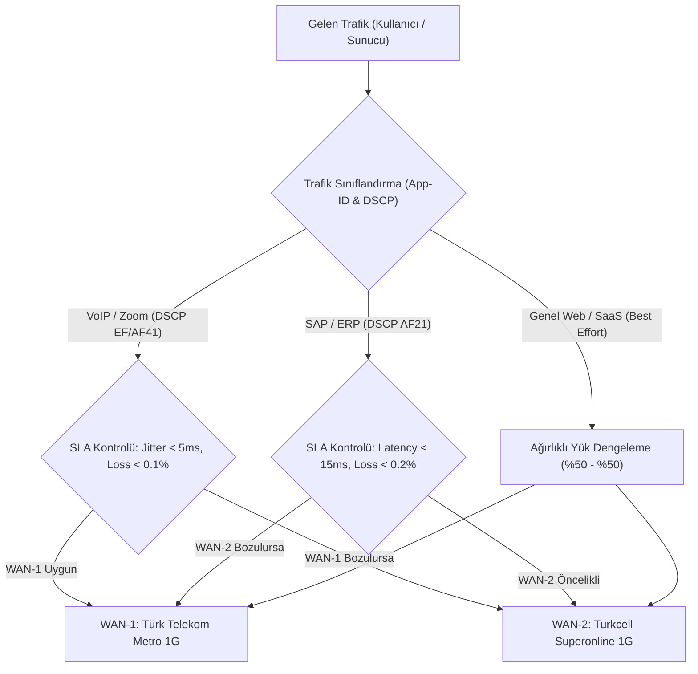

# Ankara Genel Merkez - Bant Genişliği ve SD-WAN Kapasite Analizi

## 1. Giriş ve Temel Parametreler
Ankara Genel Merkezi, toplam 300 personelin yanı sıra şubelerin merkezi Hub terminasyon noktası olarak görev yapmaktadır. Trafik mühendisliği hesaplamaları, kurumsal iş saatlerindeki pik (en yüksek) eşzamanlı kullanıcı yüküne dayanmaktadır.

* **Toplam Personel ($N_{toplam}$):** 300
* **Pik Eşzamanlılık Oranı ($\alpha_{concurrency}$):** %90
* **Pik Aktif Kullanıcı Sayısı ($N_{aktif}$):** $300 \times 0.90 = 270$ aktif kullanıcı

---

## 2. Bant Genişliği İhtiyaç Formülasyonu ve Hesaplama

Toplam bant genişliği gereksinimi ($BW_{toplam}$), genel veri trafiği ($BW_{veri}$), gerçek zamanlı ses/video iletişimi ($BW_{voip}$), merkezi ERP/SAP veri akışı ($BW_{erp}$) ve protokol yükü/yedek tampon payı ($BW_{tampon}$) toplamı olarak hesaplanır:

$$BW_{toplam} = BW_{veri} + BW_{voip} + BW_{erp} + BW_{tampon}$$

### 2.1. Trafik Bileşenlerinin Ayrıştırılması

1. **Genel Veri ve İnternet Erişimi ($BW_{veri}$):**
   * Kullanıcı başı ortalama garanti edilen bant genişliği: $R_{kullanici} = 3.0\text{ Mbps}$ (Web browsing, SaaS araçları, e-posta, doküman transferi).
   * $$BW_{veri} = N_{aktif} \times R_{kullanici} = 270 \times 3.0\text{ Mbps} = 810\text{ Mbps}$$

2. **Gerçek Zamanlı Ses ve Video Konferans ($BW_{voip}$):**
   * VoIP Telefon Trafiği: G.711 codec (64 kbps ses + L2/IP/UDP/RTP başlıkları = 87.2 kbps / çağrı).
   * HD Video Konferans (Zoom / MS Teams 1080p): Ortalama $1.5\text{ Mbps}$ / kullanıcı.
   * Peak anında personelin %30'unun görüntülü/sesli toplantıda olduğu kabul edilirse ($N_{toplanti} = 270 \times 0.30 = 81\text{ oturum}$):
     * $81 \times 1.5\text{ Mbps} = 121.5\text{ Mbps}$
   * Kalan 189 personelin %20'si klasik sesli aramada ($N_{ses} = 38\text{ arama}$):
     * $38 \times 0.0872\text{ Mbps} \approx 3.31\text{ Mbps}$
   * $$BW_{voip} = 121.5 + 3.31 \approx 124.81\text{ Mbps}$$ (İşaretleme: DSCP EF ve AF41)

3. **Merkezi ERP / SAP S/4HANA ve Veri Tabanı Eşleme ($BW_{erp}$):**
   * Ankara HQ - Veri Merkezi arası SAP GUI, Fiori HTTPS, batch dosya aktarımları ve replikasyon:
   * $$BW_{erp} = 150.0\text{ Mbps}\text{ (Ayrılmış / Rezerv Trafik)}$$ (İşaretleme: DSCP AF21)

4. **Protokol Ek Yükü ve Güvenlik Teftiş Tamponu ($BW_{tampon}$):**
   * IPsec kapsülleme, TCP yeniden iletimleri ve SSL/TLS el sıkışma ek yükü için %10 güvenlik marjı:
   * $$BW_{tampon} = (810 + 124.81 + 150) \times 0.10 = 108.48\text{ Mbps}$$

### 2.2. Toplam Peak Tüketim Özeti

$$BW_{toplam} = 810 + 124.81 + 150 + 108.48 = 1193.29\text{ Mbps} \approx 1.20\text{ Gbps}$$

---

## 3. Hat Mimarisi ve Taşıyıcı Altyapısı

Hesaplanan 1.2 Gbps peak yükü tek bir hat üzerinden taşımak tekil hata noktası (SPOF) ve kapasite darboğazı yaratacağından, **Aktif/Aktif (Dual-Active) 1 Gbps Metro Ethernet** altyapısı tesis edilmiştir:

| Taşıyıcı Hat | Servis Sağlayıcı (ISP) | Bağlantı Türü | Nominal Kapasite | SLA Taahhüdü | Teslim Arayüzü |
| :--- | :--- | :--- | :--- | :--- | :--- |
| **WAN-1 (Birincil)** | Türk Telekom | Metro Ethernet (Simetrik Fiber) | 1.0 Gbps | %99.999 Uptime, RTT < 10ms | 1G SFP LX Fiber (NGFW Port eth1/1) |
| **WAN-2 (İkincil)** | Turkcell Superonline | Metro Ethernet (Simetrik Fiber) | 1.0 Gbps | %99.999 Uptime, RTT < 10ms | 1G SFP LX Fiber (NGFW Port eth1/2) |
| **Toplam Agrega** | *Farklı Fiziksel Rota* | **Hibrit Metro Ethernet** | **2.0 Gbps** | **N+1 Tam Yedeklilik** | **LACP / SD-WAN Bundle** |

---

## 4. SD-WAN Trafik Yönlendirme ve SLA Politikaları

Akıllı SD-WAN motoru (App-aware dynamic path selection), trafiği uygulama kategorilerine ve canlı hat metriklerine (SLA) göre dinamik olarak yönlendirir:

### 4.1. SD-WAN Performans SLA Eşikleri

1. **Hassas Ses/Video (Voice/Video SLA):**
   * Azami Gecikme (Latency): $\le 20\text{ ms}$
   * Azami Seğirme (Jitter): $\le 5\text{ ms}$
   * Azami Paket Kaybı (Packet Loss): $\le 0.1\%$
   * Eşik aşılırsa: Otomatik olarak paket kaybı olmayan diğer WAN hattına kesintisiz (hitless) oturum aktarımı.

2. **Kritik Kurumsal Veri (Mission-Critical ERP SLA):**
   * Azami Gecikme: $\le 30\text{ ms}$
   * Azami Paket Kaybı: $\le 0.2\%$
   * Öncelik: WAN-2 (Daha düşük rota sekmesi nedeniyle SAP sunucularına doğrudan peer).

3. **Genel İnternet ve Standart HTTP/HTTPS:**
   * İki hat arasında Session-based ECMP (Equal-Cost Multi-Path) yük dağıtımı.
