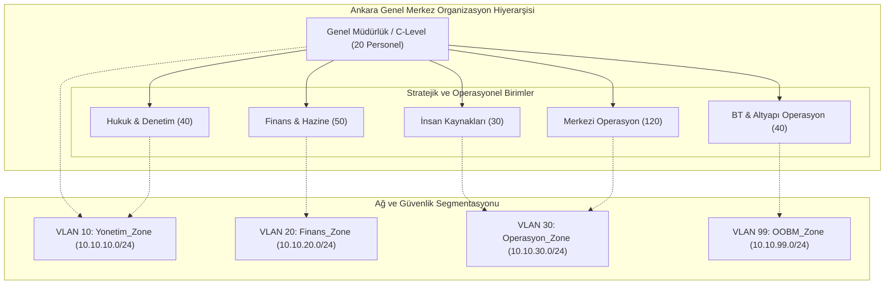

# Ankara Genel Merkez - Şube Profili ve Organizasyon Mimarisi

## 1. Genel Tanım ve Lokasyon Rolü
Ankara Genel Merkezi, holdingin ve bağlı üniversite/AR-GE yapısının stratejik yönetim, finansal karar alma, insan kaynakları ve merkezi operasyonel yönetim merkezidir. Kurumsal karar alıcıların, üst düzey yöneticilerin ve merkezi ERP/SAP sistem yöneticilerinin yer aldığı bu lokasyon, ağ omurgasının birincil Hub (merkez) noktası ve Tier-3 kurum içi veri merkezine doğrudan erişim kapısıdır.

* **Lokasyon:** Çankaya, Ankara
* **Personel Kapasitesi:** 300 Personel (Tam zamanlı / Hibrit)
* **Ağ Rolü:** SD-WAN Hub & Birincil Kurumsal Gateway (HQ Core Hub)
* **Çalışma Rejimi:** 7/24 Kesintisiz Operasyon (Kritik Finans ve Operasyonel Süreçler)

---

## 2. Departman Dağılımı ve Organizasyon Şeması

| Departman | Personel Sayısı | Rol ve Sorumluluk Alanları | Kritik Veri / Sistem Erişimi | Yetki Düzeyi |
| :--- | :---: | :--- | :--- | :--- |
| **Yönetim Kurulu & C-Level** | 20 | Stratejik yönetim, holding idaresi, kurumsal kararlar | Yönetim Kurulu Portalı, M&A Verileri, C-Level Raporlama | Seviye 1 (En Yüksek / Gizli) |
| **Finans & Hazine** | 50 | Bütçe, muhasebe, SWIFT, bordro, bankacılık entegrasyonları | SAP S/4HANA Finance, SWIFT Terminal, Banka API, E-Fatura | Seviye 2 (Mali / PCI-DSS Uyumu) |
| **İnsan Kaynakları (İK)** | 30 | İşe alım, özlük dosyaları, performans ve bordro | HRMS (Workday/SAP SuccessFactors), Özlük Arşivi | Seviye 3 (KVKK / PII Hassas) |
| **Merkezi Operasyon & Lojistik**| 120 | Tedarik zinciri, filo yönetimi, şube koordinasyonu | SAP Supply Chain, EBYS, CRM, WMS Depo Yönetimi | Seviye 4 (Kurumsal Standart) |
| **BT & Altyapı Yönetimi** | 40 | Ağ, sunucu, güvenlik operasyonu ve helpdesk | OOBM, Veri Merkezi Core, Firewall CLI, Active Directory | Seviye 0 (Sistem Yönetimi) |
| **Hukuk ve Denetim** | 40 | Hukuki süreçler, iç denetim, uyumluluk | Sözleşme Deposu, Hukuk Otomasyonu, Denetim Logları | Seviye 2 (Gizli Hukuki Veri) |
| **Toplam** | **300** | - | - | - |

---

## 3. Organizasyonel Ağ Hiyerarşisi (Mermaid)

---

## 4. Kullanılan Kritik İş Uygulamaları ve Veri Akış Modeli

1. **SAP S/4HANA Private Cloud / On-Premise Core:**
   * Finans ve Operasyon birimlerinin kalbi olan ERP sistemi.
   * Protokoller: RFC (TCP 3300-3399), SAP GUI (TCP 3200-3299), HTTPS Fiori (TCP 443), HANA DB Client (TCP 30013-30015).
2. **SWIFT Alliance Lite2 / Hazine Gateway:**
   * Finans departmanının bankalar arası uluslararası para transferleri ve fon yönetimi için kullandığı izole finansal terminaller.
   * Donanımsal HSM ve IPsec VPN üzerinden doğrudan Merkez Bankası ve aracı banka gateway'lerine terminasyon.
3. **Merkezi Kimlik ve Dizin Hizmetleri (Active Directory & PKI):**
   * Windows Server 2022 Active Directory Domain Services (HQ-DC01, HQ-DC02).
   * Kurumsal CA (Microsoft Certificate Authority) ile 802.1X EAP-TLS sertifika dağıtımı.
4. **Elektronik Belge Yönetim Sistemi (EBYS) & İntranet:**
   * Operasyon ve Hukuk departmanlarının resmî yazışmaları için kullanılan TLS 1.3 şifreli web uygulaması.
5. **Unified Communications (Cisco CallManager / Microsoft Teams & Zoom):**
   * 300 adet Cisco IP Telefon ve video konferans odaları.
   * SIP (UDP 5060), SRTP (UDP 16384-32767).

---

## 5. Donanım ve Uç Nokta Profili

* **Masaüstü / Dizüstü Bilgisayarlar:** 300 Kurumsal Cihaz (Kurumsal Windows 11 Enterprise & macOS for C-Level). Tamamı BitLocker / FileVault ile tam disk şifrelemeli.
* **Kurumsal EDR:** CrowdStrike Falcon / Palo Alto Cortex XDR yüklü ve NAC (Network Access Control - Cisco ISE) uyumluluk doğrulaması zorunludur.
* **IP Telefonlar:** Cisco 8845 Video IP Phone (PoE 802.3af ile Cisco Catalyst erişim anahtarlarına bağlı).
* **Yazıcı ve Tarayıcılar:** 15 adet ağ yazıcısı (VLAN 30 içinde sabit rezerve IP alanında, dış internete ve yönetim ağına erişimi tamamen engelli).
