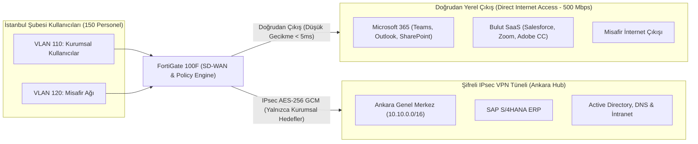

# İstanbul Şubesi - Bant Genişliği ve Trafik Mühendisliği Mimarisi

## 1. Hat Kapasitesi ve Temel Mimarisi
İstanbul ofisinde toplam 150 kurumsal personel ve günlük ortalama 30-50 eşzamanlı misafir cihazı bulunmaktadır. Lokasyonda **500 Mbps Simetrik Fiber İnternet (Direct Internet Access - DIA)** hattı tahsis edilmiştir.

* **Fiziksel WAN Bağlantısı:** 500 Mbps Simetrik Metro Ethernet (Türk Telekom Kurumsal Fiber)
* **Yedek Taşıyıcı Hat:** 100 Mbps Simetrik Fiber (Vodafone Net Kurumsal)
* **SD-WAN Operasyonu:** Dual-WAN Aktif/Yedek ve Trafik Tabanlı Bölme (Split-Tunneling / Dynamic Steering)

---

## 2. Direct Internet Access (DIA) ve Hub Tünel Ayrımı (Trafik Mühendisliği)

Geleneksel mimarilerde tüm şube trafiği merkez (Ankara) üzerinden dolaştırıldığında (backhauling), SaaS uygulamalarında (Microsoft 365, Teams, Salesforce) yüksek gecikme (latency), jitter ve Ankara Hub hattında gereksiz tıkanıklık oluşmaktadır. 

İstanbul şubesinde bu problemi çözmek için **Uygulama Duyarlı Yerel İnternet Çıkışı (Application-Aware Direct Internet Access)** uygulanmıştır.

---

## 3. Trafik Dağılımı ve Bant Genişliği Bütçesi

| Trafik Türü | Hedef / Protokol | Yönlendirme Yolu | Tahsis Edilen / Beklenen Bant Genişliği | Öncelik (QoS Sınıfı) |
| :--- | :--- | :--- | :--- | :--- |
| **Microsoft 365 & Teams** | M365 Optimize IP/URL Listesi (Audio/Video/SharePoint) | Doğrudan WAN-1 (DIA) | 180 Mbps (Pik: 80 çağrı x 1.5M + senkronizasyon) | Yüksek (DSCP AF41) |
| **Kurumsal SaaS & Web** | Salesforce, Google, Adobe CC, Genel Web | Doğrudan WAN-1 (DIA) | 150 Mbps | Standart (Best Effort) |
| **Misafir Ağı (Guest)** | Genel İnternet | Doğrudan WAN-1 (DIA) | 50 Mbps (Kullanıcı başı 5 Mbps hard-cap limit) | Düşük (DSCP CS1) |
| **Merkez ERP / SAP** | Ankara Sunucu Çiftliği (`10.10.105.0/24`) | IPsec VPN Tüneli | 60 Mbps (Kritik Finans/Satış Verisi) | Yüksek (DSCP AF21) |
| **Kurumsal AD & İntranet**| Ankara DC Sunucuları (`10.10.100.0/24`) | IPsec VPN Tüneli | 20 Mbps (Kerberos, LDAP, SMB İntranet) | Orta (DSCP AF31) |
| **Dinamik Tepe Tamponu** | Patlama (Burst) Kapasitesi | Esnek Kullanım | 40 Mbps | - |
| **Toplam Kapasite** | - | - | **500 Mbps** | - |

---

## 4. SD-WAN Performans SLA ve Yönlendirme Kuralları

FortiGate SD-WAN motoru üzerinde aşağıdaki kurallar tanımlanmıştır:
1. **Kural 1 - Şirket İçi Trafik (RFC 1918 Hedefler):**
   * Hedef: `10.10.0.0/16`, `10.40.0.0/16`, `10.50.0.0/16`
   * Arayüz: `IPSec-Ankara-Hub`
   * Failover: Eğer birincil IPsec tüneli düşerse, ikincil WAN-2 üzerinden kurulu yedek IPsec tüneline 1 saniye içinde aktarılır.
2. **Kural 2 - Microsoft 365 ve Video Konferans:**
   * Hedef: `ISDB (Internet Service Database) - Microsoft-Office365`, `Zoom`
   * Arayüz: `wan1` (Doğrudan Yerel Çıkış)
   * SLA Kriteri: Gecikme $\le 25\text{ ms}$, Seğirme $\le 5\text{ ms}$, Paket Kaybı $\le 0.5\%$.
3. **Kural 3 - Misafir Ağı İzolasyonu:**
   * Hedef: `any`
   * Arayüz: `wan1` (Statik Port/IP NAT)
   * Kural Şartı: Misafir arayüzünden (`internal.120`) gelen hiçbir paket `IPSec-Ankara-Hub` arayüzüne yönlendirilemez.
