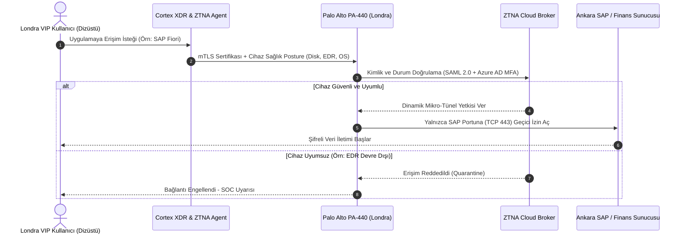

# Londra Şubesi - Bant Genişliği, Transatlantik Gecikme ve ZTNA Analizi

## 1. Hat Altyapısı ve Kapasite Planı
Londra Şubesi, yüksek hacimli kullanıcı sayısına değil, son derece düşük gecikmeli (ultra-low latency), kayıpsız ve yüksek güvenlikli veri aktarımına ihtiyaç duyar. Canary Wharf ofisi için **300 Mbps Simetrik Özel Metro Fiber İnternet** tahsis edilmiştir.

* **Birincil Hat:** 300 Mbps Dedicated Internet Access (DIA) - Colt Technology Services (Tier-1 Avrupa Taşıyıcısı)
* **İkincil Hat (Yedek):** 100 Mbps Simetrik Fiber - BT Business (British Telecom)
* **Toplam Kapasite:** 300 Mbps Taahhütlü (CIR %100, 1:1 Kontratsız Bant Genişliği)

---

## 2. Transatlantik ve Uluslararası Gecikme (Latency) Optimizasyonu

Londra ile Ankara Genel Merkezi arasındaki coğrafi mesafe (~3.000 km karayolu/fiber rotası) doğal bir ışık hızı gecikmesine yol açar. Ağ mühendisliği hedefimiz, bu gecikmeyi fiziksel alt sınırlarda tutmak ve TCP/IP darboğazlarını önlemektir:

| Metrik | Londra - Ankara Hedef Değer | Sektör Standartı | Uygulanan Optimizasyon Mekanizması |
| :--- | :--- | :--- | :--- |
| **Gidiş-Dönüş Gecikmesi (RTT / Latency)** | **< 48 ms** (Colt Premium IP omurgası) | 70 - 90 ms | Tier-1 doğrudan fiber peering, gereksiz L3 sekme eliminasyonu |
| **Gecikme Değişimi (Jitter)** | **< 2.0 ms** | 10 - 15 ms | Donanımsal IPsec kuyruğu (Hardware Crypto Acceleration) |
| **Paket Kaybı (Packet Loss)** | **< 0.01%** | < 0.5% | Strict Bandwidth Reservation & Shaping |
| **TCP Pencere Büyütme (Window Scaling)** | Aktif (RFC 7323) | Varsayılan 64 KB | Yüksek BDP (Bandwidth-Delay Product) için 16 MB Buffer |

### 2.1. Bandwidth-Delay Product (BDP) Hesabı
$$BDP = \text{Bant Genişliği (bps)} \times \text{Gecikme (RTT saniye)}$$
$$BDP = 300.000.000\text{ bps} \times 0.048\text{ s} = 14.400.000\text{ bit} = 1.80\text{ Megabayt (MB)}$$

*Sonuç:* Londra ile Ankara arasındaki 300 Mbps hattın tam kapasite kullanılabilmesi için TCP Buffer (Socket Window) boyutu en az 2 MB olarak ayarlanmış ve BBR (Bottleneck Bandwidth and RTT) tıkanıklık kontrol algoritması devreye alınmıştır.

---

## 3. Sıfır Güven Ağ Erişimi (ZTNA) Trafik Modeli

Geleneksel "kullanıcıyı doğrudan tüm iç ağa bağlayan" kalın VPN tünelleri yerine, Londra ofisi için **Prisma Access / CloudGen ZTNA mimarisi** uygulanmıştır:

---

## 4. Uygulama Bazlı Bant Genişliği Tahsisi

* **Bloomberg Professional & Refinitiv Eikon:** 40 Mbps (Ultra-Low Latency, öncelikli kuyruk).
* **Telepresence & Video Konferans (Cisco/Teams):** 60 Mbps (DSCP EF ve AF41 garantili).
* **Ankara Hub ZTNA Tüneli (Kritik Raporlama & SAP):** 100 Mbps (Şifreli IPsec AES-256).
* **Yerel Güvenli Web & SaaS Erişimi:** 80 Mbps (SSL Decryption denetimli).
* **Yedek / Protokol Payı:** 20 Mbps.
