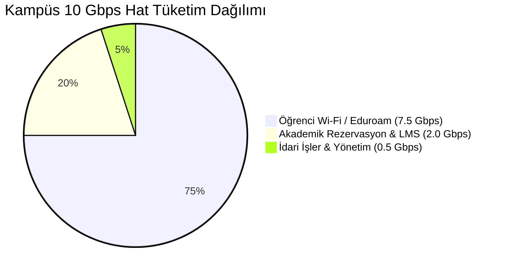

# Akademik Şube ve Kampüs - Bant Genişliği ve Kapasite Mühendisliği

## 1. Giriş ve Matematiksel Boyutlandırma Modeli
Üniversite kampüsü, holding bünyesindeki en yüksek hacimli veri akışının gerçekleştiği alandır. 10.000 öğrencinin eşzamanlı internet talebi ve 700 akademik/idari personelin kritik sistem erişimleri için telekomünikasyon endüstrisi standartlarında kuyruk ve aşırı tahsisat (overbooking/oversubscription) modelleri uygulanmıştır.

---

## 2. Peak Eşzamanlılık ve Bant Genişliği Formülasyonu

### 2.1. Eşzamanlı Aktif Cihaz Sayısı ($N_{aktif}$)
Kampüs genelinde öğrenci nüfusunun pik saatlerdeki (amfi araları ve akşam yurt saatleri) eşzamanlı aktif cihaz oranı %40 olarak ölçülmüştür:
$$N_{aktif} = N_{ogrenci} \times \alpha_{es_zamanli}$$
$$N_{aktif} = 10.000 \times 0.40 = 4.000\text{ Eşzamanlı Aktif Cihaz}$$

### 2.2. Dinamik Kullanıcı Başı Bant Genişliği ve Aşırı Tahsisat Formülü
İnternet trafiği doğası gereği patlamalı (bursty) ve asenkron olduğundan, tüm kullanıcılar aynı mikrosaniyede tam hat hızını çekmez. Bu sebeple kurumsal kampüs ağlarında standart overbooking oranı $C_{overbooking} = 1:4$ (yani 0.25) kabul edilir.

Kullanıcı başı dinamik per-user rate limit: $R_{limit} = 7.5\text{ Mbps}$ (5 - 10 Mbps dinamik aralık):

$$BW_{ogrenci} = N_{aktif} \times R_{limit} \times C_{overbooking}$$
$$BW_{ogrenci} = 4.000 \times 7.5\text{ Mbps} \times \frac{1}{4} = 4.000 \times 1.875\text{ Mbps} = 7.500\text{ Mbps} = 7.5\text{ Gbps}$$

### 2.3. Akademik Sistemler ve Kritik Altyapı Rezervasyonu ($BW_{akademik}$)
Öğrenci genel internet kullanımının akademik araştırmaları ve çevrimiçi dersleri kesintiye uğratmaması için ayrılmış garantili rezervasyon:
* **Öğrenim Yönetim Sistemi (LMS Moodle HD Video):** 800 Mbps
* **Akademik Personel Zoom / Teams / Canlı Amfi Yayınları:** 700 Mbps
* **Bilimsel Veri İndirme & Uluslararası Kütüphane Taramaları:** 500 Mbps
* $$BW_{akademik} = 2.000\text{ Mbps} = 2.0\text{ Gbps}\text{ (Garantili Ayrılmış Bant Genişliği)}$$

### 2.4. İdari İşler, ÖBS ve Yönetim Trafiği ($BW_{idari}$)
* Rektörlük, Öğrenci İşleri ve EBYS sistemleri için:
* $$BW_{idari} = 500\text{ Mbps} = 0.5\text{ Gbps}$$

---

## 3. Toplam Kapasite İhtiyacı ve Hat Agregasyonu

$$BW_{toplam} = BW_{ogrenci} + BW_{akademik} + BW_{idari}$$
$$BW_{toplam} = 7.5\text{ Gbps} + 2.0\text{ Gbps} + 0.5\text{ Gbps} = 10.0\text{ Gbps}$$

Kampüs omurgası için **10 Gbps tam hat hızında** çift taşıyıcılı simetrik Metro Ethernet altyapısı tesis edilmiştir:

| Taşıyıcı Hat | Altyapı Sağlayıcı | Bağlantı Türü | Hat Hızı | Rol ve Trafik Dağılımı |
| :--- | :--- | :--- | :--- | :--- |
| **WAN-1 (Akademik Peering)** | **ULAKBİM (TÜBİTAK)** | 10G SFP+ LR Single-Mode Fiber | 10.0 Gbps | Eduroam, Akademik Veritabanları, LMS ve Ulusal Araştırma Ağları |
| **WAN-2 (Ticari İnternet)** | **Türk Telekom Kurumsal** | 10G SFP+ LR Single-Mode Fiber | 10.0 Gbps | Öğrenci Wi-Fi Genel İnternet, Sosyal Medya, Video Akışları |
| **Toplam Agrega Kapasite** | - | **2x 10G LACP Aktif/Aktif** | **20.0 Gbps (N+1 Tam Yedekli)** | BGP Anycast / Dynamic Policy Routing |

---

## 4. Trafik Dağılımı ve Önceliklendirme Matrisi (QoS)

1. **Öğrenci Wi-Fi Trafiği:** FortiGate/Palo Alto üzerinde per-IP traffic shaper ile sınırlandırılır. Bir öğrenci tek başına azami 10 Mbps çekebilir; hat doygunluğa ulaştığında dinamik olarak 5 Mbps tabanına indirilir.
2. **Akademik ve LMS Trafiği:** Hiçbir koşulda kısıtlanamaz (Guaranteed Min Bandwidth: 2 Gbps). DSCP AF21 ve EF etiketleriyle donanımsal yüksek öncelikli kuyrukta (Strict Priority Queue) iletilir.
