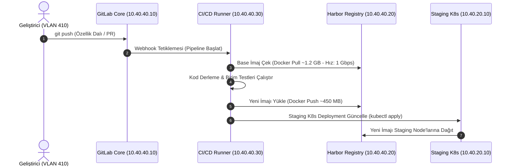

# Yazılım Ekibi - Ağ Gereksinimleri ve CI/CD Altyapı Analizi

## 1. Ağ Trafiği Karakteristiği ve İhtiyaç Analizi
Yazılım geliştirme ortamları, geleneksel ofis trafiğinden temelde farklıdır. İnternet gezinmesi düşüktür; ancak yerel ağ içerisinde devasa boyutlu ikili (binary) dosyalar, Docker konteyner imajları (her biri 500 MB - 2 GB), npm/pip paket bağımlılıkları ve veritabanı dump transferleri gerçekleşir.

Bu trafiğin geliştiricilerin kod derleme (build) sürelerini uzatmaması ve CI/CD süreçlerini yavaşlatmaması için **1 Gbps adanmış simetrik omurga hattı ve 10G uplink agregasyonu** tesis edilmiştir.

---

## 2. CI/CD Boru Hattı ve Konteyner Trafik Modeli

---

## 3. Dahili Bant Genişliği ve Throughput Hesaplamaları

| Süreç / Bileşen | Eşzamanlı Yük | Ortalama Veri Boyutu | Gereken Anlık Hız | Altyapı Çözümü |
| :--- | :--- | :--- | :--- | :--- |
| **Git Push / Fetch** | 80 Geliştirici | 5 MB - 50 MB / commit | 200 Mbps Peak | Yerel GitLab Server (VLAN 440) |
| **Docker Base İmaj Çekme** | 6 Eşzamanlı CI Runner | 800 MB - 2.5 GB / pipeline | 800 Mbps - 1 Gbps | Harbor Private Registry (10G SFP+ Core bağlı) |
| **Nexus Paket Önbelleği** | Node.js, Python, Java derlemeleri | 100 MB - 500 MB bağımlılık | 400 Mbps Peak | Nexus Caching Proxy (Dış internet trafiğini %85 azaltır) |
| **Staging DB Replike / Sync** | Günlük Veritabanı Testleri | 5 GB - 20 GB test dump | 1 Gbps Line-Rate | L3 Firewall Inter-VLAN Routing (FastPath) |

---

## 4. Altyapı Donanım ve Switch Yapılandırması

* **Geliştirici Masaüstü Switchleri:** Cisco Catalyst 9300 48-Port PoE+ (Her geliştirici masasına 1 Gbps adanmış Full-Duplex bakır Cat6A uç).
* **DevOps Sunucu Bağlantıları:** Dedicated CI Runner ve Harbor sunucuları, sunucu omurgasına (Cisco Nexus 93180YC-FX3) çift 10G SFP+ DAC kablo ile LACP (LACP Port-Channel 20 Gbps) üzerinden bağlanmıştır.
* **Jumbo Frames (MTU 9000):** VLAN 420 ve VLAN 440 arayüzlerinde konteyner imaj aktarım hızını artırmak ve CPU interrupt yükünü azaltmak amacıyla MTU değeri `9000` (Jumbo Frame) olarak ayarlanmıştır.
