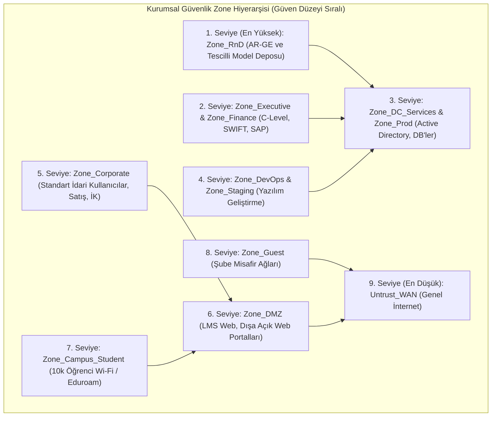

# Kurumsal Güvenlik Politikası, Zone Hiyerarşisi ve Sıfır Güven Standartları

## 1. Temel Güvenlik Felsefesi ve Mimari Standartlar
Kurumsal holding ve üniversite ağ altyapısının tüm bileşenlerinde üç temel güvenlik ilkesi istisnasız olarak uygulanır:

1. **Varsayılan Olarak Engelle (Default-Deny):**
   * Açıkça izin verilmemiş olan her protokol, port, IP ve uygulama akışı güvenlik duvarı kurallarının en altında yer alan nihai kural (`Rule 999: EXPLICIT_DENY_ALL`) ile sessizce veya loglanarak engellenir.
2. **En Az Ayrıcalık Prensibi (Least Privilege):**
   * Kullanıcılara ve sistem servislerine yalnızca görevlerini yerine getirebilmeleri için mutlak surette ihtiyaç duydukları kaynaklara, belirlenmiş zaman aralıklarında ve kısıtlı protokollerle erişim yetkisi verilir. Geniş `any-any` kuralları kesinlikle yasaktır.
3. **Sıfır Güven Mimarisi (Zero Trust Architecture - NIST SP 800-207):**
   * "Asla Güvenme, Her Zaman Doğrula (Never Trust, Always Verify)". Ağın içinde veya dışında olmak bir cihaza otomatik güven sağlamaz. Kimlik (User-ID), cihaz sağlık durumu (Device Posture) ve oturum davranışı sürekli olarak denetlenir.

---

## 2. Güvenlik Bölgeleri (Security Zones) ve Güvenilirlik Hiyerarşisi

Güvenlik duvarları üzerindeki tüm fiziksel ve mantıksal arayüzler, güvenlik seviyelerine göre derecelendirilmiş Zone hiyerarşisine dahil edilmiştir. Trafik her zaman yüksek güvenli bir bölgeden düşük güvenli bölgeye veya eşit bölgeler arasında katı denetime tabidir:

---

## 3. Bölgeler Arası Geçiş (Inter-Zone Matrix) Kuralları

| Kaynak Bölge | Hedef Bölge | Standart Politika | Gerekli Denetim ve Güvenlik Profili |
| :--- | :--- | :---: | :--- |
| **Trust_Executive / Finance** | **Untrust_WAN** | Kontrollü İzin | Tam SSL Decryption + DLP + URL Filtering + WildFire |
| **Trust_Finance** | **Trust_Corporate** | **ENGELLE (DENY)** | Departmanlar arası yanal hareket (Lateral Movement) yasak |
| **Zone_Dev_Workstation** | **Zone_Production_Data** | **ENGELLE (DENY)** | Doğrudan erişim yasak; MFA Bastion Host zorunlu |
| **Zone_RnD_Enclave** | **Untrust_WAN** | **ENGELLE (DENY)** | Sadece onaylı akademik makale sitelerine tek yönlü indirme izni |
| **Zone_Campus_Student** | **Zone_Campus_Admin / DC**| **ENGELLE (DENY)** | Kampüs idari ve veritabanı ağlarına mutlak erişim engeli |
| **Zone_Campus_Student** | **Zone_DMZ (LMS)** | Kontrollü İzin | Web Application Firewall (WAF) + Rate Limiting |
| **Zone_Guest** | **Bütün İç Bölgeler** | **MUTLAK ENGELLE** | Yalnızca harici WAN DNS/Web çıkışı |
| **Untrust_WAN (Dış Dünya)**| **Bütün İç Bölgeler** | **ENGELLE (DENY)** | Dışarıdan içeriye başlatılan oturumlar donanımsal olarak kapatılır |

---

## 4. Kural Yaşam Döngüsü ve Değişiklik Yönetimi (Change Management)

1. **Talep ve İş Gerekçesi:** Açılması talep edilen her kural için JIRA ITSM üzerinden kural talep formu (Kaynak IP, Hedef IP, Port/Uygulama, Süre, İş Gerekçesi) doldurulur.
2. **Kıdemli Güvenlik Mimarı Onayı:** Kural açılmadan önce ağ mimarı ve CISO onayı alınır.
3. **Otomatik Süre Sonu (Shadow Rule Expiration):** Geçici test veya taşeron firma erişimleri için tanımlanan kurallara azami 30 günlük son kullanma tarihi (`Rule Expiration Date`) atanır. Süre bittiğinde kural otomatik pasife alınır.
4. **Yıllık Kural Temizliği (Rule Recertification):** Son 90 gün boyunca tek bir paket dahi geçmemiş olan kullanılmayan kurallar (`Zero-Hit Rules`), her çeyrek dönemde Panorama/FortiManager raporlarıyla tespit edilip sistemden temizlenir.
