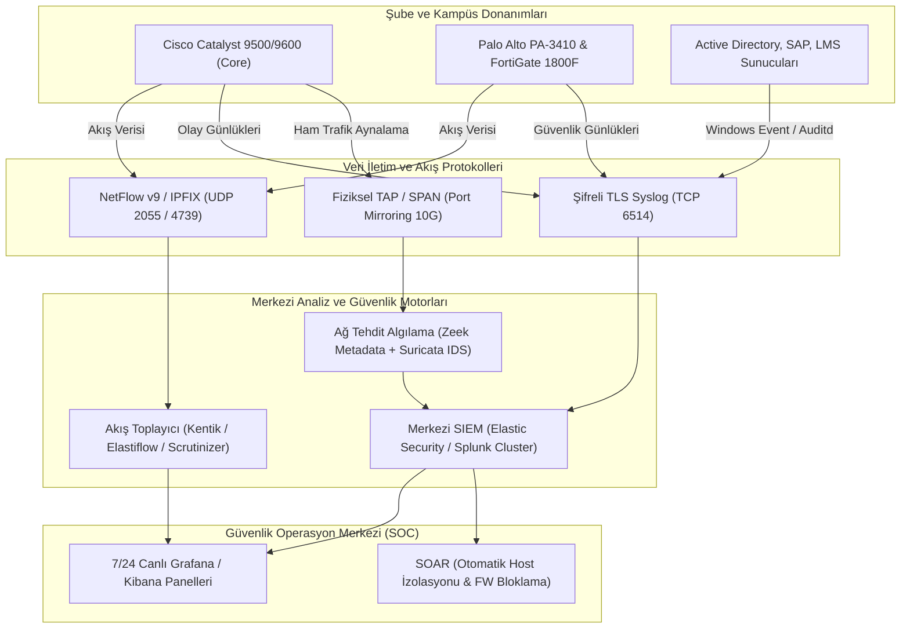

# Sistematik Ağ İzleme, Akış Toplama ve Tehdit Algılama (NDR/SIEM) Mimarisi

## 1. Mimari Genel Bakış
Holding ve üniversite kampüsünü kapsayan dağıtık altyapıda siber güvenlik görünürlüğü üç temel teknolojik sütun üzerine inşa edilmiştir:
1. **Ağ Akış Analizi (Flow Analytics - NetFlow v9 / IPFIX / sFlow):** Bant genişliği sömürüsü, top talkers, olağandışı trafik patlamaları ve anomali tespiti.
2. **Merkezi Log Yönetimi ve SIEM (Splunk Enterprise / Elastic Security):** Tüm şube ve sunuculardan TLS şifreli (Port 6514) log toplama, korelasyon kuralları ve uyarı mekanizmaları.
3. **Ağ Tehdit Algılama ve Yanıt (NDR - Zeek & Suricata):** Omurga TAP ve SPAN portlarından ham paket teftişi, C2 tespiti, DoS ve yanal hareket analizi.

---

## 2. Uçtan Uca İzleme Mimarisi (Mermaid)

---

## 3. Akış Toplama Mimarisi (NetFlow v9, IPFIX, sFlow)

### 3.1. Protokol Tercihleri ve Görev Dağılımı
* **Cisco Core Switchler (Kampüs ve Ankara HQ):** Esnek NetFlow (Flexible NetFlow - FNF) ve IPFIX kullanılır. 1:1 örnekleme (Full sampling) ile iç ağ Doğu-Batı (East-West) trafik haritası çıkarılır.
* **Firewallar (FortiGate ve Palo Alto):** IPFIX (RFC 7011) akışları üretilir. App-ID etiketleri ve NAT çevrim kayıtları (NEL - Network Event Logging) akış içine gömülerek gönderilir.
* **Erişim Kenar Switchleri (Access Layer):** 1:1000 oranlı sFlow kullanılarak port bazlı aşırı kullanım (Bandwidth Hogging) izlenir.

### 3.2. Flow Record Şablonu (IPFIX Alanları)
Akış toplayıcılara gönderilen her kayıtta şu alanlar zorunludur:
`sourceIPv4Address`, `destinationIPv4Address`, `sourceTransportPort`, `destinationTransportPort`, `protocolIdentifier`, `ipClassOfService (DSCP)`, `ingressInterface`, `egressInterface`, `octetDeltaCount`, `packetDeltaCount`, `flowStartMilliseconds`, `flowEndMilliseconds`.

---

## 4. Merkezi SIEM Mimarisi (Splunk / Elastic Security)

### 4.1. Güvenli Syslog İletimi (TLS Syslog RFC 5425)
* Tüm log kaynakları, şifresiz düz metin (UDP 514) yerine zorunlu olarak **TLS 1.3 şifreli TCP Port 6514** kullanır.
* Karşılıklı sertifika doğrulaması (Mutual TLS - mTLS) uygulanır; sertifikasız hiçbir cihaz SIEM kümesine log basamaz.

### 4.2. Log Kaynakları ve Günlük Hacim Bütçesi

| Log Kaynağı | Protokol / Format | Günlük Log Hacmi (GB/gün) | Olay Hızı (EPS - Events/Sec) |
| :--- | :--- | :--- | :--- |
| **Ankara HQ NGFW (PA-3410)** | CEF (Common Event Format) over TLS 6514 | 45 GB | 3.500 EPS |
| **Kampüs NGFW (FortiGate 1800F)** | FortiOS WELF over TLS 6514 | 180 GB | 14.000 EPS |
| **İstanbul & Londra NGFW'leri** | Syslog over TLS 6514 | 20 GB | 1.500 EPS |
| **Active Directory & DNS (HQ & Kampüs)** | Windows Event Forwarding (WEF / Winlogbeat) | 90 GB | 7.000 EPS |
| **Linux Sunucular & Veritabanları** | Auditd / Filebeat | 50 GB | 4.000 EPS |
| **Toplam SIEM Yükü** | - | **~385 GB / Gün** | **~30.000 EPS Peak** |

---

## 5. Ağ Tehdit Algılama (NDR): Zeek ve Suricata Entegrasyonu

Kampüs ve Genel Merkez omurga anahtarlarının kritik bağlantı noktalarına optik TAP (Test Access Point) ve 10G SPAN portları yerleştirilmiştir.

1. **Suricata IDS / IPS Motoru:**
   * İmza tabanlı bilinen saldırı tespiti (Emerging Threats Pro & kurumsal özel kural setleri).
   * DoS saldırıları, SYN Flood, UDP Amplification, CVE istismar denemeleri (Log4j, EternalBlue vb.) milisaniyeler içinde alarm üretir.
2. **Zeek (Bro) Ağ Güvenlik İzleme:**
   * İmzasız, protokol metaveri analizi yapar.
   * DNS tünelleme, SSL sertifika anomalileri (süresi geçmiş veya şüpheli CA imzaları), kurumsal ağda ilk defa görülen User-Agent başlıkları ve şüpheli SSH oturum süreleri Zeek tarafından JSON formatında loglanır ve SIEM'e aktarılır.
