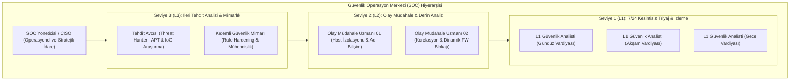
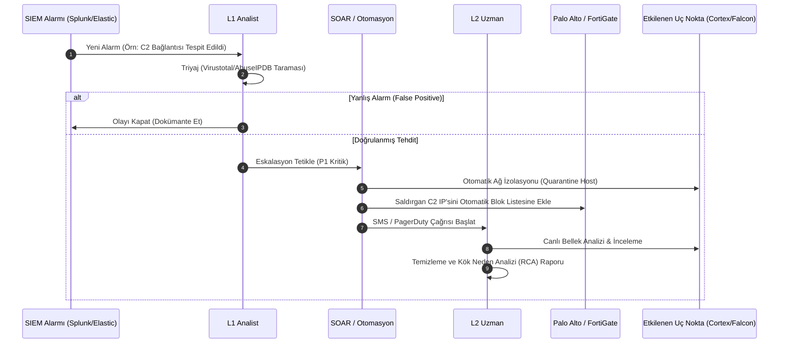

# Güvenlik Operasyon Merkezi (SOC) Yapısı, İnsan Kaynağı ve Müdahale Mimarisi

## 1. SOC Misyonu ve Operasyonel Kapsam
Güvenlik Operasyon Merkezi (SOC), holding ve üniversite genelindeki tüm ağ cihazları, sunucular, uç noktalar ve kullanıcı hesaplarından gelen güvenlik alarmlarını 7/24 kesintisiz izleyen, analiz eden, doğrulayan ve olası siber saldırılara anında müdahale eden merkezi operasyon birimidir.

---

## 2. SOC Personel Hiyerarşisi ve Rol Dağılımı

### 2.1. Seviye 1 (L1) Güvenlik Analisti
* **Çalışma Modeli:** 7/24 Vardiyalı (8 Saatlik 3 Vardiya: 08:00-16:00, 16:00-00:00, 00:00-08:00).
* **Temel Görevler:**
  - SIEM ve EDR konsoluna düşen alarmların gerçek zamanlı ilk triyajı.
  - Yanlış alarmların (False-Positive) standart playbook'lara göre elenmesi.
  - Şüpheli aktivitelerin ilk incelemesi (IP itibar sorgusu, kullanıcı teyidi, hash kontrolü).
  - Gerçek tehdit niteliği taşıyan olayların L2 seviyesine eskalasyonu.

### 2.2. Seviye 2 (L2) Olay Müdahale Uzmanı (Incident Responder)
* **Çalışma Modeli:** 5/2 (Mesai İçi + 7/24 On-Call Nöbet).
* **Temel Görevler:**
  - L1'den eskale edilen alarmların derin korelasyon analizi.
  - İhlal şüphesi olan cihazların EDR üzerinden ağ bağlantısının derhal izole edilmesi (Host Network Quarantine).
  - Güvenlik duvarları üzerinde dinamik IP/URL/Domain blokajlarının açılması.
  - Bellek (RAM) ve disk adli kopyalarının (Forensic Artifacts) alınarak saldırının yayılma yolunun (Kill Chain) çıkarılması.

### 2.3. Seviye 3 (L3) Kıdemli Güvenlik Mimarı ve Tehdit Avcısı (Threat Hunter)
* **Temel Görevler:**
  - Gelişmiş Kalıcı Tehditlerin (APT) ve sistemde sessizce bekleyen ajanların proaktif olarak tespiti (MITRE ATT&CK matrisine göre avcılık).
  - Güvenlik duvarı kural setlerinin ve IPS imzalarının periyodik sıkılaştırılması (Hardening).
  - Tehdit istihbaratı (Threat Intelligence - MISP) beslemelerinin SIEM motoruna entegre edilmesi ve yeni korelasyon senaryolarının yazılması.

---

## 3. Olay Öncelik Seviyeleri ve Hizmet Düzeyi Taahhütleri (SLA)

| Öncelik Seviyesi | Olay Tanımı ve Örnek Senaryo | İlk Müdahale Süresi (MTTA) | Çözüm / İzolasyon Hedefi (MTTR) | Bildirim ve Eskalasyon |
| :--- | :--- | :---: | :---: | :--- |
| **P1 - Kritik (Critical)** | Finans/SAP sunucusunda fidye yazılımı (Ransomware), AR-GE model deposuna yetkisiz sızma, Veri sızıntısı (Exfiltration) | **$\le 15\text{ Dakika}$** | **$\le 1\text{ Saat}$** | L1 -> L2 -> L3 -> CISO ve Genel Müdürlük anlık SMS/Telefon araması |
| **P2 - Yüksek (High)** | Öğrenci ağından idari sunuculara DoS/DDoS saldırısı, Domain Controller üzerinde brute-force başarısı, C2 trafiği | **$\le 30\text{ Dakika}$** | **$\le 2\text{ Saat}$** | L1 -> L2 -> L3 E-posta ve Telegram/Teams Acil Kanalı |
| **P3 - Orta (Medium)** | Tekil kullanıcı bilgisayarında engellenmiş zararlı yazılım, misafir ağından iç ağa port tarama denemesi | **$\le 2\text{ Saat}$** | **$\le 8\text{ Saat}$** | L1 -> L2 JIRA ITSM Çağrısı |
| **P4 - Düşük (Low)** | Önemsiz spam e-posta raporu, standart kategori blokaj bildirimleri | **$\le 8\text{ Saat}$** | **$\le 24\text{ Saat}$** | L1 Standart Bilet Kapatma |

---

## 4. Olay Müdahale İş Akışı (Playbook Adımları)

