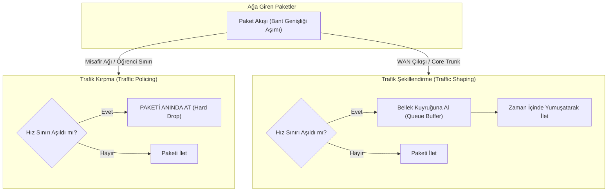

# Hizmet Kalitesi (QoS), DSCP İşaretleme ve Bant Genişliği Yönetimi Politikası

## 1. Mimari Amaç ve Kapsam
Holding ve üniversite kampüsü genelinde yüksek hacimli internet kullanımı ve video akışları mevcuttur. Hat doygunluğu yaşandığı anlarda bile sesli aramaların (VoIP) kesilmemesi, finansal ERP/SAP işlemlerinin donmaması ve kritik yönetim iletişiminin etkilenmemesi için Layer 2 (CoS 802.1p) ve Layer 3 (DSCP DiffServ RFC 2474/2475) tabanlı Hizmet Kalitesi (QoS) mimarisi uygulanır.

---

## 2. Kurumsal DSCP İşaretleme ve Önceliklendirme Matrisi

| Trafik Sınıfı | Örnek Uygulamalar | DSCP Değeri | Hex / Decimal | Kuyruk Türü | Garanti Edilen Bant Genişliği | Azami Gecikme Bütçesi |
| :--- | :--- | :---: | :---: | :--- | :---: | :---: |
| **Kritik Gerçek Zamanlı Ses (VoIP Voice)**| Cisco IP Telefonlar, SIP Ses Paketleri | **EF (Expedited Forwarding)** | `0x2E / 46` | PQ (Strict Priority Queue) | %10 Hat Kapasitesi | $< 10\text{ ms}$ |
| **İnteraktif Video Konferans** | Zoom, Microsoft Teams, Webex HD Video | **AF41 (Assured Forwarding 41)**| `0x22 / 34` | CBWFQ / Yüksek Öncelik | %25 Hat Kapasitesi | $< 30\text{ ms}$ |
| **Kritik Kurumsal Veri (Mission-Critical)**| SAP S/4HANA, Hazine SWIFT, Veritabanı | **AF21 (Assured Forwarding 21)**| `0x12 / 18` | CBWFQ / Orta-Yüksek | %30 Hat Kapasitesi | $< 50\text{ ms}$ |
| **Kurumsal İdari Trafik (Transactional)**| Active Directory, EBYS, CRM, E-Posta | **AF31 (Assured Forwarding 31)**| `0x1A / 26` | CBWFQ / Standart | %20 Hat Kapasitesi | $< 80\text{ ms}$ |
| **Genel İnternet ve Web (Best Effort)** | Standart Web Gezinme, SaaS Araçları | **DF / CS0 (Default Forwarding)**| `0x00 / 0` | Standart FIFO | Kalan Kapasite | Best Effort |
| **Düşük Öncelikli / Eğlence (Scavenger)**| Öğrenci Wi-Fi Bulk Trafik, Sosyal Medya, P2P | **CS1 (Scavenger Class)** | `0x08 / 8` | Sıkıştırılmış / Düşük Öncelik | Azami %15 (Darboğazda %2'ye Düşürülür) | Toleranslı |

---

## 3. Trafik Şekillendirme (Traffic Shaping) vs. Trafik Kırpma (Traffic Policing)

Trafik sınırlandırma kararları, trafiğin türüne ve sınır noktasına göre iki farklı kuyruk disipliniyle yönetilir:

### 3.1. Hangi Durumda Hangisi Kullanılır?
1. **Traffic Policing (Kırpma - Hard Rate-Limit):**
   * **Kullanım Yeri:** Misafir Wi-Fi (VLAN 120) ve Öğrenci Wi-Fi (VLAN 300-305) giriş portları.
   * **Çalışma Şekli:** Bir öğrenci tanımlanan 10 Mbps limitini aştığı mikrosaniyede fazla paketler belleğe alınmaz; anında `drop` edilir. Bu sayede switch/firewall RAM belleği korunur ve TCP penceresi hızını kendiliğinden düşürür.
2. **Traffic Shaping (Şekillendirme - Soft Buffer Smoothing):**
   * **Kullanım Yeri:** Ankara HQ ve Kampüs Metro Ethernet WAN çıkış arabirimleri.
   * **Çalışma Şekli:** Hat hızını aşan kurumsal SAP veya VoIP paketleri atılmaz; bellek kuyruklarında tutularak hattın boşaldığı milisaniyelerde yumuşatılarak iletilir (Sıfır paket kaybı).

---

## 4. Darboğaz ve Doygunluk Anında Otomatik Bant Genişliği Sıkma Prosedürü

WAN hat kullanım oranı %90'ın üzerine çıktığında (Kapasite doygunluğu alarmı), omurga switch ve güvenlik duvarları üzerinde otomatik aşamalı sıkma devreye girer:

1. **Aşama 1 (Hat Kullanımı > %85 - 5 Dakika Süreyle):**
   * Ağırlıklı Rastgele Erken Tespit (**WRED - Weighted Random Early Detection**) algoritması devreye girer.
   * CS1 (Scavenger / Öğrenci Bulk) etiketli paketler TCP pencere boyutunu küçültmek için rastgele düşürülmeye başlanır. EF (VoIP) ve AF21 (SAP) paketlerine kesinlikle dokunulmaz.
2. **Aşama 2 (Hat Kullanımı > %95 - 60 Saniye Süreyle):**
   * Öğrenci Wi-Fi bant genişliği tavanı kişi başı dinamik olarak **10 Mbps'den 3 Mbps'ye** çekilir.
   * YouTube, Twitch, Netflix ve TikTok gibi video akış servislerinin çözünürlüğü L7 QoS kuralıyla maksimum 480p seviyesine zorlanır (Bandwidth throttling).
3. **Aşama 3 (Hat Normale Döndüğünde < %75):**
   * Histerezis (Hysteresis) mekanizması ile 10 dakika boyunca hat yükünün %75'in altında kaldığı doğrulanır.
   * Bant genişliği kotaları kademeli olarak varsayılan kurumsal seviyelerine geri yükseltilir.
