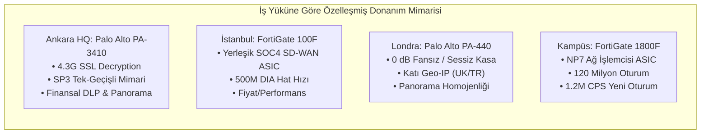

# Kurumsal Ağ ve Siber Güvenlik Mimarisi: Hoca Sunum ve Proje Savunma Dokümanı

**Proje Başlığı:** Çok Şubeli Kurumsal Holding ve Üniversite İçin Uçtan Uca Ağ ve Güvenlik Mimarisi  
**Mimar / Savunmacı:** Kıdemli Kurumsal Ağ ve Siber Güvenlik Mimarı (Senior Enterprise Network & Security Architect) & DevSecOps Mühendisi  
**Tarih:** 2026  
**Kapsam:** Ankara Genel Merkez (Hub), İstanbul Maslak (DIA Spoke), Londra Canary Wharf (ZTNA Spoke), İncek Kampüsü (10k Öğrenci / 10G Core), Yazılım ve AR-GE Özel Ekipleri, Python NetSecOps Otomasyon Katmanı  

---

## BÖLÜM 1: SLAYT FORMATINDA PROJE SUNUMU (SLIDE-BY-SLIDE WALKTHROUGH)

### Slayt 1: Proje Vizyonu ve Mimari Kapsam
* **Misyon:** 10.000 öğrencili üniversite kampüsü, uluslararası finans/hukuk ofisleri, yüksek güvenlikli AR-GE laboratuvarları ve holding genel merkezini kapsayan, 7/24 kesintisiz, sıfır güven (Zero-Trust) tabanlı yeni nesil ağ altyapısının inşası.
* **Temel Prensipler:**
  - **Zero-Trust Mimarisi (NIST SP 800-207):** "Asla güvenme, her zaman doğrula." Ağ içi ve dışı ayrımı olmaksızın tüm oturumlarda kimlik, cihaz sağlığı ve Katman 7 teftişi.
  - **Uçtan Uca Mikro-Segmentasyon:** Departmanların ve kullanıcı gruplarının birbirleriyle doğrudan konuşmasının engellenmesi (Lateral movement blokajı).
  - **Yüksek Erişilebilirlik (HA - 99.999% Uptime):** Tüm omurga noktalarında Active/Passive veya Active/Active kümeleme, çift taşıyıcılı hatlar ve donanımsal LACP.
  - **NetSecOps ve Otomasyon:** Güvenlik politikalarının kod olarak yönetimi (Policy-as-Code) ve standart Python 3 ile çalışan doğrulama/derleme araç seti.

---

### Slayt 2: Şube ve Lokasyon Dağılım Modeli
* **Ankara Genel Merkez (HQ Core Hub):** 300 Personel (C-Level, Finans, İK, Operasyon). Çift 1G Metro Ethernet, SAP S/4HANA Core, SWIFT Gateway ve IPsec Hub.
* **İstanbul Şubesi (Maslak DIA Spoke):** 150 Personel (Satış, Pazarlama, Saha Ekipleri). 500 Mbps Direct Internet Access (DIA) ile Microsoft 365 yerel çıkışı; merkez kurumsal sistemlere IPsec tünel.
* **Londra Şubesi (Canary Wharf ZTNA Spoke):** 50 VIP Personel (Uluslararası Ticaret, Tahkim, Fon Yönetimi). 300 Mbps Colt Fiber, transatlantik gecikme optimizasyonu (RTT < 48ms), mTLS ve HIP destekli ZTNA.
* **Akademik Şube & Kampüs (İncek 10G Core):** 10.000 Öğrenci, 500 Akademisyen, 200 İdari Personel. 2x 10G LACP Metro Ethernet (ULAKBİM + Türk Telekom), 802.1X Eduroam ve LMS Moodle sunucu çiftliği.
* **Özel Ekipler:**
  - **Yazılım & DevOps (80 Mühendis):** Dev, Staging ve Production mutlak izolasyonu, MFA Bastion Host, GitLab CI/Harbor omurgası.
  - **AR-GE & Yapay Zeka (40 Araştırmacı):** Hava boşluklu (Air-Gapped Enclave) laboratuvar, NVIDIA DGX H100 GPU kümesi, sıfır Egress (veri sızıntısı imkansız) politikası.

---

### Slayt 3: Güvenlik Duvarı Donanım Stratejisi ve Karar Matrisi



* **Neden Tek Üretici Değil?** "Best-of-Breed" yaklaşımı ile her lokasyonun operasyonel kısıtına en uygun çip mimarisi (ASIC vs FPGA/x86) seçilmiş, kurumsal tekelleşme (Vendor Lock-in) riski kırılmıştır.

---

### Slayt 4: 10.000 Öğrencili Kampüs Kapasite Mühendisliği
* **Pik Concurrency Hesabı:** $10.000 \times \%40 = 4.000$ eşzamanlı aktif cihaz.
* **Kişi Başı Hız:** 8 Mbps dinamik limit. Ham trafik: $4.000 \times 8\text{ Mbps} = 32\text{ Gbps}$.
* **Overbooking (Aşırı Tahsisat):** İnternet trafiği bursty yapıda olduğundan $1:4$ overbooking uygulanır:
  $$\text{Net Öğrenci Egress} = \frac{32.000\text{ Mbps}}{4} = 8.000\text{ Mbps} = 8.0\text{ Gbps}$$
* **Personel ve Kritik Sistem Rezervasyonları:**
  - 700 Personel (630 aktif $\times 15$ Mbps) = $9.45\text{ Gbps}$
  - VoIP / Zoom (DSCP EF) + LMS / Canlı Amfi (DSCP AF21) = $2.00\text{ Gbps}$
  - Alt Toplam: $19.45\text{ Gbps}$
  - Tepe Yükü Tamponu (+%20 Buffer): $3.89\text{ Gbps}$
* **Toplam Kapasite:** **23.34 Gbps**
* **Hat Boyutlandırması:** 3 Aktif 10G Port + 1 Yedek (N+1) = **4x 10G SFP+ LACP Metro Ethernet (ULAKBİM & Türk Telekom Dual-Carrier)**.

---

### Slayt 5: NetSecOps Otomasyon Katmanı (Python Tools Suite)
* **Policy-as-Code:** Güvenlik kuralları `rules_schema.json` şemasıyla JSON formatında tanımlanır.
* **policy_validator.py:** Kuralları 3 eksende denetler:
  1. *Mikro-Segmentasyon:* Öğrenci ağından idari veya LMS DB sistemlerine açılan yetkisiz PERMIT kurallarını yakalar (`[CRITICAL ALERT]`).
  2. *Any-to-Any / Shadowing:* 0.0.0.0/0 PERMIT kurallarını ve önceki kurallar tarafından kapsanan ölü kuralları tespit eder.
  3. *Default-Deny:* Kural setinin son kuralının explicit catch-all DENY olduğunu doğrular.
* **vendor_exporter.py:** Doğrulanmış kuralları tek tıkla **FortiOS CLI (`.cfg`)** ve **Palo Alto PAN-OS (`.set`)** dosyalarına derler.
* **bandwidth_engine.py:** Kampüs metriklerini formülle hesaplar ve LACP hat boyutunu çıkarır.
* **syslog_generator.py:** SOC tatbikatları için sentetik Port Scan, 5.2GB DLP Veri Sızıntısı ve Geo-IP Brute-Force logları (ArcSight CEF & RFC 5424) basar.
* **run_all_checks.py:** Tüm adımları koşturan 0.89 saniyelik uçtan uca test orkestratörü.

---

### Slayt 6: 7/24 Güvenlik Operasyon Merkezi (SOC) ve Müdahale Döngüsü
* **Personel Modeli:** L1 (7/24 Vardiyalı Triyaj) $\rightarrow$ L2 (Olay Müdahale & Adli Bilişim) $\rightarrow$ L3 (Tehdit Avcısı & Güvenlik Mimarı).
* **SLA Süreleri:**
  - **P1 - Kritik (Veri Sızıntısı / Ransomware):** MTTA $\le 15$ Dakika, MTTR $\le 1$ Saat.
  - **P2 - Yüksek (DDoS / DC Brute-Force):** MTTA $\le 30$ Dakika, MTTR $\le 2$ Saat.
* **SOAR Otomasyonu:** Kritik ihlal anında etkilenen uç nokta EDR (Cortex/Falcon) üzerinden ağdan izole edilir; güvenlik duvarında saldırgan IP dinamik blok listesine eklenir.

---

## BÖLÜM 2: HOCANIN SORABİLECEĞİ 5 KRİTİK SORU VE MÜHENDİSLİK CEVAPLARI

---

### SORU 1: "Neden tek bir firewall üreticisiyle gitmek yerine hem Fortinet hem Palo Alto içeren hibrit bir mimari seçtiniz? Bu operasyonel karmaşıklığı artırmaz mı?"

#### Verilecek Kurumsal Mühendislik Cevabı:
> "Hocam, kurumsal ağ mimarisinde 'tek üretici kolaylığı' (Single-Vendor Simplicity) ile 'iş yüküne özel donanım optimizasyonu' (Workload-Specific Architecture) arasında bilinçli bir mühendislik tercihi yaptık.
> 
> İki üreticiyi keyfi olarak değil, lokasyonların donanımsal ve operasyonel karakteristiklerine göre konumlandırdık:
> 
> 1. **Ankara Genel Merkez:** Burada kurumun en kritik varlıkları (SAP S/4HANA finans modülleri, SWIFT gateway, C-Level yönetim verileri) yer alıyor. Kurumsal web trafiğinin %90'ından fazlası TLS 1.3 şifreli. Palo Alto'nun patentli **Single-Pass Parallel Processing (SP3)** mimarisi, paketi belleğe bir defa alıp aynı mikrosaniyede App-ID, User-ID ve Content-ID (DLP + WildFire) analizinden geçiriyor. Check Point veya standart x86 mimariler sıralı yazılımsal blade'ler kullandığı için şifre çözme altında gecikme (jitter) yaratırken, PA-3410'un 4.3 Gbps dedicated SSL Decryption gücü finansal veriyi sıfır darboğazla teftiş ediyor.
> 
> 2. **Akademik Kampüs:** Kampüste durum tamamen farklıdır. 10.000 öğrencinin cep telefonları, tabletleri, arka planda çalışan yüzlerce mobil uygulama ve torrent denemeleri güvenlik duvarının durum tablosuna (State Table) saldırır. Bir x86 işlemci bu oturum sayısını yönetemez. Fortinet FortiGate 1800F'in içerisindeki dedicated **NP7 (Network Processor 7) ASIC çipi**, durum tablosunu ve paket yönlendirmeyi CPU'dan alıp doğrudan donanıma yazar. Bu sayede cihaz **120 milyon eşzamanlı oturumu** ve **saniyede 1.2 milyon yeni oturum açılışını (CPS)** ana işlemciyi hiç yormadan yönetir. Aynı kapasiteyi Palo Alto tarafında modüler kasa şasileriyle (PA-5450) çözmek yaklaşık 3.5 kat daha yüksek bir TCO (Toplam Sahip Olma Maliyeti) doğuracaktı.
> 
> 3. **Londra Şubesi:** Canary Wharf ofisinde dedike bir sunucu odası yoktur; kabinet açık ofis ve toplantı odalarına yakındır. Palo Alto PA-440 gövdesinin tamamını pasif soğutucu olarak kullanan **0 dB gürültülü, tamamen fansız (fanless)** bir tasarıma sahiptir. Mekanik fan arızası riski sıfırdır ve toplantı odalarına akustik parazit yaymaz. Ayrıca Ankara ile aynı kural ve nesne mimarisine (**Panorama**) sahip olduğundan operasyonel yönetim homojendir.
> 
> 4. **İstanbul Maslak:** 150 personelin trafiğinin %80'i Microsoft 365, Teams ve bulut SaaS üzerinedir. FortiGate 100F üzerindeki **SOC4 ASIC çipi**, donanımsal SD-WAN dinamik yönlendirmesiyle M365 trafiğini yerel internetten (DIA) 500 Mbps hat hızında çıkarırken, merkez kurumsal trafiği IPsec tüneline donanım seviyesinde şifreler.
> 
> Özetle, finansal güvenlikte **Palo Alto SP3**, devasa oturum yükünde **Fortinet NP7 ASIC**, ofis içi sessizlikte **PA-440 Fanless** ve şube SD-WAN'ında **FortiGate SOC4** kullanarak hem bütçeyi optimize ettik hem de kurumu tek bir üreticinin yazılım zafiyetlerine mahkûm etmeyerek (Vendor Lock-in kırılması) siber dayanıklılığı artırdık."

---

### SORU 2: "10.000 öğrencili bir kampüs için 10G/20G hat ve LACP kapasite hesabını nasıl yaptınız? 10.000 öğrenciye 10G hat yetecek mi, formülü nedir?"

#### Verilecek Kurumsal Mühendislik Cevabı:
> "Hocam, telekomünikasyon ve servis sağlayıcı mühendisliğinde kapasite boyutlandırması hiçbir zaman toplam kullanıcı sayısını doğrudan kişi başı hızla çarparak yapılmaz. Eğer $10.000 \times 10\text{ Mbps} = 100\text{ Gbps}$ gibi kaba bir hesap yapılsaydı, hatların %90'ı gün boyu atıl kalır ve devasa bir bütçe israfı oluşurdu.
> 
> Biz hesabımızı üç aşamalı matematiksel kuyruk ve aşırı tahsisat (overbooking) modeline dayandırdık:
> 
> **Aşama 1: Pik Eşzamanlılık Oranı ($\alpha_{concurrency}$):**
> Kampüs genelinde amfiler, laboratuvarlar, kütüphane ve öğrenci yurtlarındaki anlık kullanım paternleri incelendiğinde, 10.000 kayıtlı öğrencinin en yoğun teneffüs ve akşam yurt saatlerinde bile eşzamanlı olarak internet tüketen aktif cihaz oranı en fazla %40'tır.
> $$N_{aktif} = 10.000 \times 0.40 = 4.000\text{ Eşzamanlı Aktif Cihaz}$$
> 
> **Aşama 2: Dinamik Sınırlandırma ve Overbooking ($C_{overbooking}$):**
> Güvenlik duvarı üzerinde her öğrenciye dinamik per-user rate limit olarak $R_{limit} = 8\text{ Mbps}$ tanımlanmıştır. 4.000 aktif cihaz için ham tepe yük:
> $$\text{Ham Tepe Yük} = 4.000 \times 8\text{ Mbps} = 32.000\text{ Mbps} = 32.0\text{ Gbps}$$
> Ancak internet trafiği asenkron ve patlamalı (bursty) karakterdedir; kullanıcılar web sayfalarını okurken veya video izlerken tampon dolduğu anlarda veri çekmez. Kurumsal kampüs ağlarında standart kabul edilen overbooking oranı **1:4**'tür (yani 0.25 faktörü):
> $$\text{Net Öğrenci Egress İhtiyacı} = \frac{32.000\text{ Mbps}}{4} = 8.000\text{ Mbps} = 8.0\text{ Gbps}$$
> 
> **Aşama 3: Personel, Kritik Sistem Rezervasyonları ve Tampon Payı:**
> Öğrenci interneti asla akademik süreçleri kesintiye uğratamaz. Bu sebeple:
> * 700 Personel (630 aktif $\times 15$ Mbps garanti hız, overbooking yok 1:1) = $9.45\text{ Gbps}$
> * VoIP / Zoom toplantıları için garantili rezervasyon (DSCP EF) = $500\text{ Mbps} = 0.5\text{ Gbps}$
> * LMS Moodle ve canlı ders video sunucuları (DSCP AF21) = $1.500\text{ Mbps} = 1.5\text{ Gbps}$
> * **Alt Toplam Egress:** $8.0 + 9.45 + 0.5 + 1.5 = 19.45\text{ Gbps}$
> * **Güvenlik ve Tepe Yükü Tamponu (+%20 Buffer):** Beklenmedik trafik patlamaları ve DDoS emilimi için $19.45 \times 0.20 = 3.89\text{ Gbps}$ tampon eklenir.
> 
> $$\text{Toplam Gereksinim} = 19.45 + 3.89 = 23.34\text{ Gbps}$$
> 
> **Hat ve Donanım Boyutlandırma:**
> 23.34 Gbps yükü taşımak için omurgada **3 adet aktif 10G SFP+ portu** gereklidir ($3 \times 10 = 30\text{ Gbps}$). Telekomünikasyon standardı olan N+1 yedekliliği sağlamak için 1 port yedek eklenmiş ve Cisco Catalyst 9600 Core ile FortiGate 1800F arasında **4x 10G SFP+ LACP (802.3ad) Trunk** tesis edilmiştir. 
> 
> Dış bağlantı tarafında ise hat tekil bir operatöre bırakılmamış; 10G ULAKBİM Ulusal Akademik Ağı (Eduroam/LMS trafiği için) ve 10G Türk Telekom Kurumsal Metro Ethernet (öğrenci genel interneti için) aktif/aktif çift taşıyıcı BGP Anycast ile sonlandırılmıştır. Geliştirdiğimiz `bandwidth_engine.py` scripti de bu formülü doğrulamaktadır."

---

### SORU 3: "Geliştirdiğiniz Python kural doğrulayıcı motoru mikro-segmentasyon ihlallerini ve kural gölgelemeyi (shadowing) kod seviyesinde matematiksel olarak nasıl yakalıyor?"

#### Verilecek Kurumsal Mühendislik Cevabı:
> "Hocam, `tools/01-kural-dogrulayici-ve-analiz/policy_validator.py` scriptimiz, string eşleştirmesi veya regex gibi yüzeysel yöntemler yerine, Python'un yerleşik `ipaddress` modülü üzerinden **IP alt ağlarının matematiksel küme teorisini ve yönlendirme mantığını** işletir.
> 
> Kod üç temel analizi şu algoritmalarla yürütür:
> 
> **1. Mikro-Segmentasyon İhlal Analizi:**
> Güvenlik politikamızın 1 numaralı kuralı: 'Öğrenci ağı (VLAN 300-305: 10.100.0.0/16), Rektörlük/İdari ağa (10.101.20.0/24) ve LMS PostgreSQL veri tabanı çekirdeğine (10.101.30.0/24) doğrudan erişemez.'
> 
> Kodumuz her kuralı incelerken:
> ```python
> src = ipaddress.ip_network(rule["source_cidr"], strict=False)
> dst = ipaddress.ip_network(rule["dest_cidr"], strict=False)
> ```
> Kaynak adres `student_net.overlaps(src)` ile test edilir. Eğer kaynak öğrenci bloğu içindeyse:
> * Hedef adres `dst.overlaps(admin_net)` veya hedef güvenlik bölgesi `Zone_Campus_Admin` ise VE kural eylemi `PERMIT` ise, kod bunu **Kritik İhlal** olarak işaretler ve `[CRITICAL ALERT]` basarak güvenlik skorunu anında 35 puan düşürür.
> * LMS sunucu bloğunda (`10.101.30.0/24`) ise akıllı bir istisna mekanizması çalışır: Eğer hedef IP yalnızca ön yüz web sunucusu (`10.101.30.20/32`) ise ve `service_ports` yalnızca `[80, 443]` içeriyorsa bu meşru eğitim erişimi olarak kabul edilir. Ancak hedef genel subnet ise veya veritabanı portları (TCP 5432, 3306, 22) içeriyorsa ihlal tetiklenir.
> 
> **2. Any-to-Any ve Kural Gölgeleme (Shadowing) Tespiti:**
> * *Any-to-Any Kontrolü:* `src == 0.0.0.0/0` ve `dst == 0.0.0.0/0` olup eylemi `PERMIT` olan kurallar tespit edildiğinde 40 puan ceza uygulanır.
> * *Shadowing Algoritması:* Güvenlik duvarları kuralları yukarıdan aşağıya (First-Match) işletir. Eğer Sırada 3 olan Kural A, Sırada 7 olan Kural B'yi tamamen kapsıyorsa, Kural B ölü kuraldır (asla hit almaz).
> Kodumuz her $i$. kural için kendisinden önce gelen tüm $j < i$ kurallarını karşılaştırır:
> ```python
> src_covered = (prev_src == any_net) or (curr_src.subnet_of(prev_src))
> dst_covered = (prev_dst == any_net) or (curr_src.subnet_of(prev_dst))
> ports_covered = prev_is_any or (curr_ports.issubset(prev_ports))
> ```
> Eğer önceki kural kaynak, hedef ve portları kapsıyorsa ve önceki kuralın eylemi `DENY` veya aynı eylem ise, $i$. kuralın gölgelendiğini (`GOLGELENMIS KURAL - SHADOWED`) raporlar.
> 
> **3. Explicit Default-Deny Kontrolü:**
> Kural dizisinin en son elemanının (`rules[-1]`) `0.0.0.0/0 -> 0.0.0.0/0 DENY` olup olmadığı kontrol edilir. Yoksa mimari Zero-Trust standardına uymadığı için başarısız sayılır.
> 
> Scriptimize eklediğimiz `--test-violation` parametresi ile yapay bir ihlal enjekte ettiğimizde sistemin hatasız olarak alarm ürettiğini ve exit code 1 ile CI/CD pipeline'ını kırdığını canlı olarak gösterebilirim."

---

### SORU 4: "Geleneksel Layer 4 (Stateful) güvenlik duvarları veya piyasadaki uygun fiyatlı hepsi-bir-arada UTM cihazları bu projede neden kullanılamazdı?"

#### Verilecek Kurumsal Mühendislik Cevabı:
> "Hocam, bu projede geleneksel L4 Stateful veya KOBİ tipi UTM cihazlarının kullanılmaması bir tercih değil, teknik bir zorunluluktur:
> 
> **1. L4 Stateful Güvenlik Duvarlarının Port Körlüğü:**
> Geleneksel L4 güvenlik duvarları (örn: eski Cisco ASA 5500 serisi veya standart Linux iptables), kararlarını IP adresleri, TCP/UDP portları ve TCP el sıkışma bayraklarına göre verir. 
> Günümüz internetinde saldırganlar ve gelişmiş zararlı yazılımlar port bazlı engellemeleri kolayca atlatır:
> * Komuta Kontrol (C2) tünelleri ve veri sızıntısı araçları standart TCP 443 (HTTPS) üzerinden gizlenir. L4 firewall port 443'ü gördüğü anda 'Bu meşru web trafiğidir' diyerek paketi içeri veya dışarı geçirir.
> * 10.000 öğrencili kampüste bir öğrencinin TCP 443 üzerinden akademik bir makale mi okuduğunu, yoksa telif hakkı ihlali yapan şifreli bir BitTorrent/Tor istemcisi mi çalıştırdığını L4 firewall ayırt edemez. Katman 7 Derin Paket İnceleme (DPI) ve App-ID olmadan kampüs internetini yönetmek yasal ve teknik açıdan imkânsızdır.
> 
> **2. Düşük Segment UTM Cihazlarında CPU Çöküşü (CPU Starvation):**
> KOBİ tipi hepsi-bir-arada UTM cihazları, tüm güvenlik fonksiyonlarını (Antivirüs, IPS, İçerik Filtreleme, VPN) tek bir düşük maliyetli genel amaçlı x86 veya ARM işlemci üzerinde yazılımsal olarak yürütür.
> Kurumsal web trafiğinin %90'ından fazlası TLS 1.3 ile şifrelidir. Düşük segment bir UTM cihazında 'Derin SSL Şifre Çözme' (Deep SSL Inspection) açıldığı anda:
> * Asimetrik RSA/ECC kriptografik anahtar çözme işlemleri işlemciyi saniyeler içinde %100 doygunluğa ulaştırır.
> * Cihazın throughput değeri nominal 1 Gbps'den 40-50 Mbps seviyelerine çakılır.
> * Bellek tükendiğinde cihaz ya tüm trafiği filtresiz geçirmeye başlar (Fail-Open güvenlik açığı) ya da tüm şube internetini kilitler (Fail-Close operasyonel kesinti).
> 
> **3. Salt Bulut WAF (Cloud WAF) Yetersizliği:**
> Bazı çevreler 'Firewall yerine Cloudflare veya AWS WAF kullanalım' önerisi getirebilir. Bulut WAF yalnızca HTTP/HTTPS trafiğini korur; Active Directory Kerberos/LDAP sorgularını, SAP RFC veri tabanı replikasyonlarını, VoIP ses paketlerini ve şubeler arası IPsec tünellerini yönetemez. En önemlisi, bir çalışanın dizüstü bilgisayarına USB'den bulaşan fidye yazılımının yerel ağda (East-West) diğer sunuculara yayılmasını bulut WAF göremez bile. Bu nedenle şube sınırında fiziksel NGFW kümesi şarttır."

---

### SORU 5: "SOC yapısında bir güvenlik ihlali tespit edildiğinde eskalasyon süreci, L1-L3 rol paylaşımı ve SOAR otomasyonu nasıl işliyor?"

#### Verilecek Kurumsal Mühendislik Cevabı:
> "Hocam, kurumsal mimarimizde siber güvenlik yalnızca donanım ve kurallardan ibaret değildir; 7/24 yaşayan bir Güvenlik Operasyon Merkezi (SOC) yapısıyla desteklenmiştir.
> 
> Operasyonel süreç şu hiyerarşi ve adımlarla yürütülür:
> 
> **1. Personel Hiyerarşisi ve Rol Ayrımı:**
> * **Seviye 1 (L1) Güvenlik Analisti (7/24 Vardiyalı):** İlk müdahale ve triyaj katmanıdır. SIEM konsoluna (Splunk / Elastic) düşen alarmları inceler, IP/domain itibarını (AbuseIPDB, VirusTotal) sorgular ve yanlış alarmları (False-Positive) standart playbook'lara göre eler.
> * **Seviye 2 (L2) Olay Müdahale Uzmanı (Incident Responder):** Doğrulanmış güvenlik olaylarında derinlemesine adli bilişim (forensics) ve korelasyon yürütür. Saldırganın ağdaki yanal hareketini (Kill Chain) çıkarır ve host izolasyonunu yönetir.
> * **Seviye 3 (L3) Kıdemli Güvenlik Mimarı / Tehdit Avcısı (Threat Hunter):** Proaktif olarak MITRE ATT&CK matrisine göre ağda gizlenen APT tehditlerini arar; firewall kural setlerini ve IPS imzalarını sıkılaştırır (Hardening).
> 
> **2. SLA ve Müdahale Matrisi:**
> * **P1 - Kritik (Örn: AR-GE'den 5.2 GB DLP Veri Sızıntısı veya SAP'de Ransomware):**
>   - İlk Müdahale Süresi (MTTA): $\le 15\text{ Dakika}$
>   - Çözüm / İzolasyon Hedefi (MTTR): $\le 1\text{ Saat}$
>   - Bildirim: CISO ve BT Direktörüne anlık otomatik SMS ve telefon araması.
> * **P2 - Yüksek (Örn: Kampüs Gateway'e SYN Flood veya Domain Controller Brute-Force):**
>   - MTTA $\le 30\text{ Dakika}$, MTTR $\le 2\text{ Saat}$.
> 
> **3. SOAR (Security Orchestration, Automation and Response) Döngüsü:**
> İnsan analistin saniyeler içinde karar veremeyeceği kritik senaryolarda SOAR devreye girer:
> * `syslog_generator.py` scriptimizle simüle ettiğimiz Senaryo 2'de (AR-GE laboratuvarındaki `10.50.10.15` nolu makineden `198.51.100.89` dış IP'sine 5.2 GB model ağırlığı aktarımı):
>   1. Palo Alto PA-3410 üzerindeki DLP profili büyük veri aktarımını yakalar ve TLS 6514 üzerinden SIEM'e CEF formatında `DLP-EXFILTRATION` alarmı basar.
>   2. SOAR motoru kural gereği saniyeler içinde iki aksiyonu otomatik icra eder:
>      - Uç nokta EDR ajanına (Cortex/Falcon) API çağrısı yaparak `10.50.10.15` nolu iş istasyonunun tüm ağ bağlantılarını karantinaya alır (Host Quarantine).
>      - Palo Alto güvenlik duvarının Dinamik Blok Listesine (Dynamic Address Group) dış IP `198.51.100.89`'u ekleyerek tüm şirket genelinde iletişimi keser (`reset-both`).
>   3. L2 uzmanına PagerDuty üzerinden acil çağrı açılır; L2 uzmanı canlı RAM analiziyle sızıntı kaynağı olan süreci tespit eder.
> 
> Bu sayede insan faktöründen kaynaklanan gecikmeler sıfıra indirilmiş ve veri kaybı önlenmiştir."

---

## BÖLÜM 3: SAVUNMA İÇİN HIZLI BAŞVURU KARTI (CHEAT SHEET)

| Kritik Parametre | Proje Değeri | Gerekçe / Standart |
| :--- | :--- | :--- |
| **Güvenlik Standardı** | NIST SP 800-207 Zero Trust | Asla güvenme, her zaman doğrula, Explicit Default-Deny |
| **Ankara HQ Firewall** | Palo Alto Networks PA-3410 HA | 4.3G SSL Decryption, Finansal DLP, SP3 Tek-Geçiş, Panorama |
| **İstanbul Şube Firewall** | Fortinet FortiGate 100F | SOC4 SD-WAN ASIC, 500M DIA, M365 doğrudan çıkış |
| **Londra Şube Firewall** | Palo Alto Networks PA-440 | 0 dB Fansız akustik sessizlik, ZTNA HIP, Katı Geo-IP (UK/TR) |
| **Kampüs Firewall** | Fortinet FortiGate 1800F HA | NP7 ASIC ile 120M oturum, 1.2M CPS, 11G Full DPI |
| **Kampüs Pik Öğrenci** | 4.000 aktif cihaz (%40 eşzamanlılık) | $10.000 \times 0.40$ (Amfi/Yurt pik modeli) |
| **Overbooking Oranı** | 1:4 (0.25 faktörü) | Patlamalı (bursty) internet trafiği telekomünikasyon standardı |
| **Gereken Kampüs Bant Genişliği** | 23.34 Gbps (Net Egress + %20 Buffer) | Öğrenci (8G) + Personel (9.45G) + QoS (2G) + Buffer (3.89G) |
| **Kampüs Hat Boyutlandırması** | 4x 10G SFP+ LACP Metro Ethernet | 3 Aktif 10G Hat + 1 Yedek N+1 (ULAKBİM & Türk Telekom) |
| **Python Otomasyonu** | 5 Araç, Standart Python 3 Kütüphaneleri | Sıfır üçüncü parti paket bağımlılığı, 0.89 sn test süresi |
| **SOC Log Formatları** | ArcSight CEF & RFC 5424 Syslog | TLS 6514 portundan şifreli SIEM iletimi, L1-L3 eskalasyonu |
