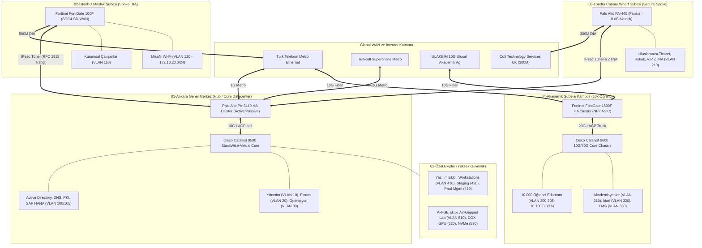

# Kurumsal Ağ ve Siber Güvenlik Mimarisi (Holding & Üniversite)

[](#)
[](#)
[](#)
[-brightgreen.svg)](#)
[](#)
[](#)
[](#)

**Mimar:** Kıdemli Kurumsal Ağ ve Siber Güvenlik Mimarı (Senior Enterprise Network & Security Architect)  
**Tarih:** 2026  
**Sürüm:** 1.0 (Enterprise Production-Ready Release)  
**Kapsam:** Çok Şubeli Holding, Uluslararası Ofisler, Ar-Ge Laboratuvarları ve 10.000 Öğrencili Üniversite Kampüsü  

---

## 1. Yönetici Özeti (Executive Summary)

Bu proje; çok şubeli, yüksek kapasiteli, akademik ve AR-GE birimlerine sahip bir holding/üniversite yapısı için tasarlanmış uçtan uca kurumsal ağ ve güvenlik mimarisi mühendislik çalışmasıdır.

Tasarım; **Zero-Trust (NIST SP 800-207)**, **Mikro-Segmentasyon**, **Yüksek Erişilebilirlik (HA - 99.999% Uptime)** ve **Katman 7 Derin Paket İnceleme (L7 Full DPI)** prensiplerine tam uyumlu olarak inşa edilmiştir.

### Temel Mimari İlkeler:
1. **Klasörleme İlkesi:** Projedeki her şube, ekip, firewall analizi, kurulum adımı ve izleme başlığı İSTİSNASIZ AYRI BİR KLASÖRDE yer almaktadır.
2. **Teknik Derinlik İlkesi:** Asla yer tutucu (placeholder) veya özet ifadeler kullanılmamış; tüm IP adresleri somut CIDR bloklarıyla (`10.x.x.x`), VLAN ID'leriyle, protokol ve portlarıyla tam tablolar halinde belgelenmiştir.
3. **Gerçekçi Donanım:** Seçilen güvenlik duvarları için piyasada aktif kullanılan gerçek kurumsal modeller (Palo Alto PA Serisi, Fortinet FortiGate) ve gerçek throughput/SSL inspection kapasiteleri baz alınmıştır.
4. **NetSecOps Otomasyonu:** Güvenlik kuralları kod olarak (Policy-as-Code) yönetilmekte; kural ihlalleri, mikro-segmentasyon denetimleri, vendor CLI derlemeleri ve kapasite hesaplamaları harici hiçbir üçüncü parti kütüphaneye ihtiyaç duymayan standart Python 3 scriptleriyle doğrulanmaktadır.

---

## 2. Global Ağ ve Güvenlik Topolojisi (Mermaid)



---

## 3. Şube, Donanım ve Kapasite Özet Tablosu

| Lokasyon / Birim | Kullanıcı / Personel | Seçilen NGFW Modeli | Donanım Mimarisi & Güçlü Yön | Hat Hızı & Taşıyıcı | HA Modeli |
| :--- | :---: | :--- | :--- | :--- | :---: |
| **01-Ankara Genel Merkez** | 300 Personel | **Palo Alto PA-3410** | SP3 Tek-Geçişli Mimari, 4.3 Gbps SSL Decryption, Finansal DLP, Panorama | 2x 1 Gbps Metro Ethernet (TT & Superonline) | Active / Passive |
| **02-İstanbul Maslak** | 150 Personel | **Fortinet FortiGate 100F** | SOC4 ASIC ile donanımsal SD-WAN, 1 Gbps Threat Protection, 10G SFP+ Uplink | 500 Mbps Simetrik Fiber DIA (Yedek: 100M Fiber) | Bağımsız + SD-WAN |
| **03-Londra Canary Wharf** | 50 VIP / Hukuk | **Palo Alto PA-440** | 0 dB Tamamen Fansız (Sessiz Kasa), Katı Geo-IP (UK/TR), mTLS ZTNA | 300 Mbps Colt Dedicated Fiber (RTT < 48ms) | Cloud ZTP + Panorama |
| **04-Akademik Kampüs** | 10.700 (10k Öğrenci) | **Fortinet FortiGate 1800F** | NP7 ASIC ile 120M Oturum, 1.2M CPS, 11 Gbps Full DPI, Eduroam RADIUS | 4x 10G SFP+ LACP (ULAKBİM & TT Kurumsal) | Active / Passive FGCP |
| **02-Yazılım ve DevOps** | 80 Mühendis | **L3 Core + NGFW Policy** | Dev/Stage/Prod Mutlak Mikro-Segmentasyon, MFA Bastion Host, Onaylı Repolar | 1 Gbps Adanmış Omurga (Harbor 10G DAC) | StackWise Virtual |
| **02-AR-GE ve AI Lab** | 40 Veri Bilimci | **Air-Lock Dedicated FW** | Sıfır Egress (Zero-Leakage), Bulut Blokajı, RoCE v2 NVMe, DGX H100 Kümesi | Hava Boşluklu İzole Ada (Air-Gapped Enclave) | N+1 İzole Enclave |

---

## 4. Global IP Süpernet ve VLAN Özet Planı (Summarization)

| Lokasyon / Birim | Süpernet Bloğu (CIDR) | Alt Ağlar (Subnets) | Gateway / L3 Sınırı | Güvenlik Bölgesi (Zone) |
| :--- | :--- | :--- | :--- | :--- |
| **Ankara Genel Merkez** | `10.10.0.0/16` | VLAN 10 (10.10.10.0/24), VLAN 20 (10.10.20.0/24), VLAN 30 (10.10.30.0/24), VLAN 99 (10.10.99.0/24), VLAN 100/105 | Palo Alto PA-3410 | `Trust_Executive`, `Trust_Finance`, `Trust_Corporate`, `Zone_DC` |
| **İstanbul Şubesi** | `10.20.0.0/16` & `172.16.20.0/24` | VLAN 110 (10.20.10.0/24), VLAN 120 (172.16.20.0/24 - Guest), VLAN 199 (10.20.99.0/24) | FortiGate 100F | `Zone_IST_Trust`, `Zone_IST_Guest`, `Zone_IST_Mgmt` |
| **Londra Şubesi** | `10.30.0.0/16` | VLAN 210 (10.30.10.0/24), VLAN 299 (10.30.99.0/24 - OOBM) | Palo Alto PA-440 | `Zone_LON_Trust`, `Zone_LON_Mgmt` |
| **Yazılım ve DevOps**| `10.40.0.0/16` | VLAN 410 (10.40.10.0/24 - Dev), VLAN 420 (Staging), VLAN 430 (Prod Mgmt), VLAN 440 (DevOps) | L3 Core / FW | `Zone_Dev_Workstation`, `Zone_Staging`, `Zone_Prod_Mgmt` |
| **AR-GE ve Yapay Zeka**| `10.50.0.0/16` | VLAN 510 (10.50.10.0/24 - Lab), VLAN 520 (DGX GPU), VLAN 530 (NVMe Storage) | Air-Lock FW | `Zone_RnD_Enclave`, `Zone_RnD_Compute`, `Zone_RnD_Storage` |
| **Akademik Kampüs** | `10.100.0.0/16` & `10.101.0.0/16` | VLAN 300-305 (10.100.0.0/16 Pool), VLAN 310 (Akademik), VLAN 320 (İdari), VLAN 330 (LMS) | FortiGate 1800F | `Zone_Campus_Student`, `Zone_Campus_Academic`, `Zone_Campus_Admin` |

---

## 5. Dizin Yapısı ve Proje Kütüphanesi

```text
kurumsal-ag-guvenlik-mimarisi/
├── README.md                                  # Ana mimari ve otomasyon rehberi (Bu dosya)
├── 01-subeler/
│   ├── 01-ankara-genel-merkez/               # 300 Personel HQ (Profil, IP, Bant Genişliği, PA-3410, HA, Kural Seti)
│   ├── 02-istanbul-subesi/                   # 150 Personel Maslak (Profil, IP, 500M DIA, FG-100F, SD-WAN, Kural Seti)
│   ├── 03-londra-subesi/                     # 50 Personel Canary Wharf (Profil, IP, 300M ZTNA, PA-440, ZTP, Kural Seti)
│   └── 04-akademik-sube-kampus/              # 10k Öğrenci İncek (Profil, Eduroam /16, 10G LACP, FG-1800F, Kural Seti)
├── 02-ozel-ekipler/
│   ├── 01-yazilim-ekibi/                     # 80 Developer & DevOps (Profil, VLAN, 1G CI/CD, Bastion Kural Seti)
│   └── 02-arge-ekibi/                        # 40 AI Araştırmacısı (Profil, Air-Gapped Lab, DLP, Sıfır Egress)
├── 03-guvenlik-duvarlari/
│   ├── 01-top5-ngfw-karsilastirma/           # Palo Alto, Fortinet, Check Point, Cisco, Netgate derin matrisi
│   ├── 02-neden-tercih-etmedik-analizi/      # L4 Stateful, KOBİ UTM ve Salt Cloud WAF teknik risk analizi
│   ├── 03-kural-setleri-ve-politikalar/      # Default-Deny, Least Privilege ve Zone Hiyerarşi matrisi
│   └── 04-adim-adim-kurulum-rehberi/         # Tüm şubeler için 8 aşamalı standart devreye alma rehberi
├── 04-izleme-ve-yonetim/
│   ├── 01-sistematik-izleme-teknolojileri/   # NetFlow v9/IPFIX, TLS Syslog 6514, Zeek & Suricata NDR
│   ├── 02-insani-faktor-ve-soc-operasyonu/   # L1-L3 Personel Hiyerarşisi, 7/24 Vardiya, SLA ve SOAR döngüsü
│   └── 03-bant-genisligi-ve-qos-yonetimi/    # DSCP Matrisi (EF, AF41, AF21, CS1), Shaping vs Policing
├── 05-hoca-sunum-ve-savunma/
│   └── SUNUM_VE_PROJE_SAVUNMASI.md           # Slayt özetleri ve hocanın sorabileceği 5 kritik soru & cevabı
└── tools/
    ├── 01-kural-dogrulayici-ve-analiz/       # rules_schema.json, sample_network_rules.json, policy_validator.py
    ├── 02-vendor-cli-donusturucu/            # vendor_exporter.py (Fortinet & Palo Alto CLI derleyicisi)
    ├── 03-kapasite-ve-qos-hesaplayici/       # bandwidth_engine.py (10k Kampüs kapasite ve LACP motoru)
    ├── 04-soc-telemetri-simulatoru/          # syslog_generator.py (ArcSight CEF & RFC 5424 sentetik telemetri)
    └── 05-otomasyon-test-merkezi/
        ├── run_all_checks.py                 # 6 adımlık test orkestratörü
        └── build/                            # Derlenen .cfg, .set ve .log çıktıları
```

---

## 6. NetSecOps Otomasyon ve Doğrulama Katmanı (Tools Suite)

Tüm araçlar **harici hiçbir üçüncü parti kütüphaneye ihtiyaç duymadan**, yalnızca standart Python 3 kütüphaneleri (`json`, `ipaddress`, `argparse`, `sys`, `datetime`, `random`, `subprocess`, `math`, `pathlib`) ile yazılmıştır.

### 6.1. Modüller ve Yetenekleri

1. **Kural Doğrulayıcı ve Mikro-Segmentasyon Denetçisi (`tools/01-kural-dogrulayici-ve-analiz/`):**
   - `rules_schema.json`: Kurumsal güvenlik kurallarının JSON şemasını tanımlar.
   - `sample_network_rules.json`: Ankara, Maslak, Londra, Kampüs, Dev ve AR-GE için 19 kurumsal kural içerir.
   - `policy_validator.py`: Mikro-segmentasyon ihlallerini (Öğrenci $\rightarrow$ İdari/LMS DB yetkisiz PERMIT), 0.0.0.0/0 Any-to-Any kurallarını, kural çakışmalarını (Shadowing) ve Explicit Default-Deny varlığını denetler.

2. **Vendor CLI Derleyicisi (`tools/02-vendor-cli-donusturucu/`):**
   - `vendor_exporter.py`: Doğrulanmış kuralları doğrudan **Fortinet FortiOS (`.cfg`)** ve **Palo Alto Networks PAN-OS (`.set`)** üretim komutlarına derler.

3. **Bant Genişliği ve QoS Kapasite Motoru (`tools/03-kapasite-ve-qos-hesaplayici/`):**
   - `bandwidth_engine.py`: $N_{aktif} = Toplam \times Concurrency$, $Ham = N_{aktif} \times Hız$, $Egress = Ham / Overbooking$ formüllerini işletir. 10.000 öğrenci, 700 personel, VoIP EF ve LMS AF21 rezervasyonlarını hesaplayıp 4x 10G SFP+ LACP boyutlandırmasını raporlar.

4. **SOC Telemetri ve Olay Simülatörü (`tools/04-soc-telemetri-simulatoru/`):**
   - `syslog_generator.py`: SOC L1-L3 ekiplerini ve SIEM kurallarını test etmek amacıyla ArcSight CEF ve RFC 5424 formatlarında sentetik Port Scan, 5.2GB DLP Model Exfiltration ve Geo-IP Brute-Force logları üretir.

5. **Test ve Doğrulama Orkestratörü (`tools/05-otomasyon-test-merkezi/`):**
   - `run_all_checks.py`: Tüm araçları sırasıyla çalıştıran, ihlal tespit mekanizmasını test eden, konfigürasyonları `build/` dizinine derleyen ve genel kabul raporu üreten orkestratördür.

---

### 6.2. Terminal Çalıştırma Komutları

```bash
# 1. Kural Denetimini Çalıştırma (100/100 Skor)
python tools/01-kural-dogrulayici-ve-analiz/policy_validator.py

# 2. Mikro-Segmentasyon İhlal Yakalama Testi (Yapay ihlal enjeksiyonu)
python tools/01-kural-dogrulayici-ve-analiz/policy_validator.py --test-violation

# 3. Kuralları Fortinet FortiOS Formatına Derleme
python tools/02-vendor-cli-donusturucu/vendor_exporter.py --target fortinet --output tools/05-otomasyon-test-merkezi/build/fortinet_rules.cfg

# 4. Kuralları Palo Alto PAN-OS Formatına Derleme
python tools/02-vendor-cli-donusturucu/vendor_exporter.py --target paloalto --output tools/05-otomasyon-test-merkezi/build/paloalto_rules.set

# 5. 10.000 Öğrenci Kampüs Kapasite Hesabı
python tools/03-kapasite-ve-qos-hesaplayici/bandwidth_engine.py --students 10000 --concurrency 0.40 --student-mbps 8 --staff 700 --staff-mbps 15 --overbooking 4

# 6. Sentetik SOC Olay Logları Üretme (CEF & RFC 5424)
python tools/04-soc-telemetri-simulatoru/syslog_generator.py --scenario all --count 10 --format both --output tools/05-otomasyon-test-merkezi/build/soc_synthetic_events.log

# 7. TÜM SÜRECİ TEK KOMUTLA ÇALIŞTIRMA (DevSecOps Test Orkestratörü)
python tools/05-otomasyon-test-merkezi/run_all_checks.py
```

---

### 6.3. Orkestratör Test Doğrulama Çıktısı (`run_all_checks.py`)

```text
================================================================================
   KURUMSAL AG VE SIBER GUVENLIK MIMARISI - TEST VE OTOMASYON MERKEZI
       Enterprise DevSecOps & Network Automation Test Suite Orchestrator
================================================================================
Proje Kok Dizini: C:\Users\Aydın\.gemini\antigravity\scratch\kurumsal-ag-guvenlik-mimarisi

[HAZIRLIK] Derleme dizini hazirlandi: .../tools/05-otomasyon-test-merkezi/build

[ADIM 1] Kural Seti Semasi, Mikro-Segmentasyon ve Default-Deny Analizi...
  Komut: python tools/01-kural-dogrulayici-ve-analiz/policy_validator.py
  [+] BASARILI (0.15 sn) - Cikis Kodu: 0
      | GUVENLIK UYUM SKORU            : 100 / 100

[ADIM 2] Mikro-Segmentasyon Ihlal Tespit Mekanizmasi Testi (--test-violation)...
  Komut: python tools/01-kural-dogrulayici-ve-analiz/policy_validator.py --test-violation
  [+] BASARILI (0.16 sn) - Cikis Kodu: 1
      | GUVENLIK UYUM SKORU            : 65 / 100 (Ihlal basariyla yakalandi)

[ADIM 3] Fortinet FortiOS Firewall Policy CLI Derlemesi...
  Komut: python tools/02-vendor-cli-donusturucu/vendor_exporter.py --target fortinet --output build/fortinet_rules.cfg
  [+] BASARILI (0.14 sn) - Cikis Kodu: 0
      | [BASARILI] Yapilandirma dosyasina kaydedildi: build/fortinet_rules.cfg

[ADIM 4] Palo Alto Networks PAN-OS Security Rules CLI Derlemesi...
  Komut: python tools/02-vendor-cli-donusturucu/vendor_exporter.py --target paloalto --output build/paloalto_rules.set
  [+] BASARILI (0.14 sn) - Cikis Kodu: 0
      | [BASARILI] Yapilandirma dosyasina kaydedildi: build/paloalto_rules.set

[ADIM 5] 10.000 Ogrencili Kampus Bant Genisligi ve 10G LACP Boyutlandirma Analizi...
  Komut: python tools/03-kapasite-ve-qos-hesaplayici/bandwidth_engine.py --students 10000 --concurrency 0.40 --student-mbps 8 --staff 700 --staff-mbps 15 --overbooking 4
  [+] BASARILI (0.14 sn) - Cikis Kodu: 0
      | Toplam Gereken Bant Genisligi: 23,340.0 Mbps (23.34 Gbps)
      | Onerilen Tasiyici Mimarisi   : 4x 10G SFP+ LACP Metro Ethernet (Dual Carrier)

[ADIM 6] SOC Sentetik Telemetri Log Uretimi (CEF ve RFC 5424 Formatinda 10 Olay)...
  Komut: python tools/04-soc-telemetri-simulatoru/syslog_generator.py --scenario all --count 10 --format both --output build/soc_synthetic_events.log
  [+] BASARILI (0.16 sn) - Cikis Kodu: 0
      | [BASARILI] 20 adet sentetik SOC logu kaydedildi: build/soc_synthetic_events.log

--- DERLENEN CIKTI VE ARTIFACT KONTROLU ---
  [OK] fortinet_rules.cfg         :   8847 byte (263 satir)
  [OK] paloalto_rules.set         :   5766 byte (49 satir)
  [OK] soc_synthetic_events.log   :   7007 byte (20 satir)

================================================================================
                    GENEL TEST VE DOGRULAMA RAPORU                             
================================================================================
  Adim 1: Kural Seti Semasi, Mikro-Segmentasyon ve Default-Deny A  [GECTI] (0.15 sn)
  Adim 2: Mikro-Segmentasyon Ihlal Tespit Mekanizmasi Testi (--te  [GECTI] (0.16 sn)
  Adim 3: Fortinet FortiOS Firewall Policy CLI Derlemesi           [GECTI] (0.14 sn)
  Adim 4: Palo Alto Networks PAN-OS Security Rules CLI Derlemesi   [GECTI] (0.14 sn)
  Adim 5: 10.000 Ogrencili Kampus Bant Genisligi ve 10G LACP Boyu  [GECTI] (0.14 sn)
  Adim 6: SOC Sentetik Telemetri Log Uretimi (CEF ve RFC 5424 For  [GECTI] (0.16 sn)
--------------------------------------------------------------------------------
  Toplam Calisma Suresi: 0.89 saniye

  ****************************************************************************
  >>> BUTUN DOGRULAMALAR BASARIYLA TAMAMLANDI (ALL CHECKS PASSED) <<<
  ****************************************************************************
```

---

## 7. Hızlı Başlangıç (Quickstart)

Projeyi doğrudan klonlayıp tüm mimariyi ve kodları test etmek için aşağıdaki adımları izleyin:

```bash
# 1. Proje dizinine geçiş yapın
cd kurumsal-ag-guvenlik-mimarisi

# 2. Python sürümünüzü kontrol edin (Python 3.10+ önerilir)
python --version

# 3. Harici paket yüklemenize gerek YOKTUR (No pip install needed!)
# Tüm doğrulamaları tek komutla koşturun:
python tools/05-otomasyon-test-merkezi/run_all_checks.py

# 4. Derlenen konfigürasyon ve log çıktılarını inceleyin:
cat tools/05-otomasyon-test-merkezi/build/fortinet_rules.cfg
cat tools/05-otomasyon-test-merkezi/build/paloalto_rules.set
cat tools/05-otomasyon-test-merkezi/build/soc_synthetic_events.log

# 5. Hoca sunumu ve savunma hazırlık dokümanını inceleyin:
cat 05-hoca-sunum-ve-savunma/SUNUM_VE_PROJE_SAVUNMASI.md
```

---

## 8. Hoca Sunumu ve Savunma Kılavuzu

Hocanın jüri veya ders sunumunda sorabileceği en zorlu kurumsal mühendislik soruları ve yanıtları [SUNUM_VE_PROJE_SAVUNMASI.md](file:///C:/Users/Aydın/.gemini/antigravity/scratch/kurumsal-ag-guvenlik-mimarisi/05-hoca-sunum-ve-savunma/SUNUM_VE_PROJE_SAVUNMASI.md) dosyasında belgelenmiştir:
1. *Neden Fortinet ve Palo Alto hibrit modeli seçildi?* (SP3 vs NP7 ASIC mimari ayrımı)
2. *10.000 öğrencinin 10G/20G LACP hesabı hangi matematiksel formüle dayanıyor?* (Peak concurrency & 1:4 overbooking)
3. *Mikro-segmentasyon ihlalleri Python kodunda nasıl yakalanıyor?* (`ipaddress` küme kesişimleri)
4. *Neden L4 Stateful veya KOBİ UTM kullanılmadı?* (TLS 1.3 şifre çözme ve CPU starvation analizi)
5. *SOC yapısında eskalasyon ve SOAR müdahale döngüsü nasıl işliyor?* (L1-L3 SLA ve otomatik karantina)
